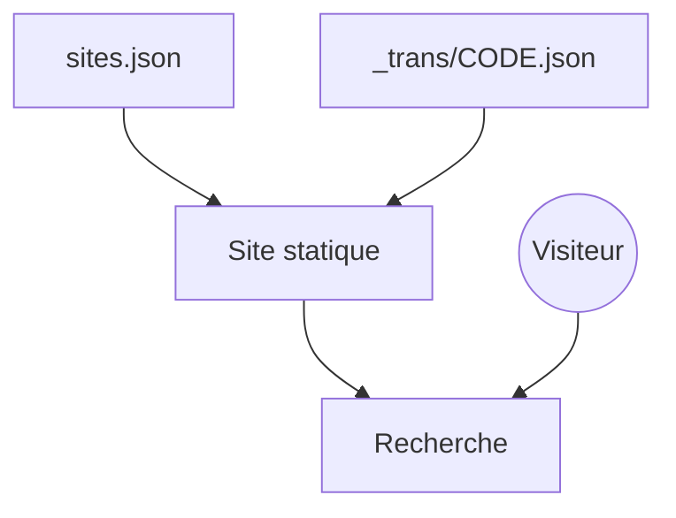

# justdeleteme/justdelete.me

> Annuaire de liens directs pour supprimer son compte sur des services web, pour tout internaute.

## Le problème
Les services cachent la page de suppression de compte, et on perd du temps à chercher comment partir.

## Ce que ça fait vraiment
Le dépôt contient `sites.json`, la liste des services avec lien direct (ou article d'aide) et une difficulté, plus des traductions dans `_trans/`. Le README ne décrit que les règles de contribution : mise à jour du dépôt, ordre alphabétique, indentation de 4 espaces, validation du JSON.

## Comment c'est branché
Schéma simplifié d'après la fiche, sans diagramme fourni.

## Essayer
Aucune commande documentée, hors `git pull` avant de contribuer.

## Coût et pièges
Gratuit. Dernier push en juin 2024 et plus de 150 issues ouvertes : les liens peuvent être périmés.

## Ce que ce n'est pas
Ce n'est pas un service qui supprime les comptes à ta place : il ne fait que pointer vers les pages. Il n'est pas garanti à jour.

## Alternatives
Aucune alternative nommée dans le README.

## Pour toi
À ignorer : annuaire grand public sans lien avec la data ou le MLOps, et sans activité récente.

