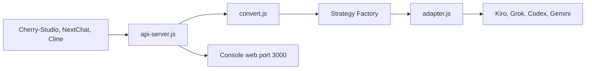

# justlovemaki/AIClient-2-API

> Local proxy that exposes models reserved to specific clients (Kiro, Grok, Codex) as an OpenAI-compatible API.

## The problem
Some models are only accessible through their official client, not through a standard API.

## What it actually does
Node.js server that converts between OpenAI, Claude and Gemini protocols, with account pool, rotation, automatic failover, health check, web console, full request logging and a TLS sidecar (Go uTLS) to imitate a browser. Connects by OAuth or SSO cookie to free or personal accounts.

## How it is wired


## Trying it
```bash
docker run -d -p 3000:3000 -p 8086:8086 -p 1455:1455 -p 56121:56121 -p 19876-19880:19876-19880 --restart=always -v "your_path/configs:/app/configs" --name aiclient2api justlikemaki/aiclient-2-api
```

## Cost and gotchas
Third-party accounts are still required; default password `admin123` to be changed. The OAuth ports must be free. The service is presented as bypassing rate and quota limits, and Cloudflare blocks.

## What it is not
Not an authorized service: it circumvents providers' restrictions, with a risk of account ban and breach of their terms. The README speaks of study use and disclaims all responsibility.

## Alternatives
No alternative named in the README.

## For you
Ignore: circumvention of providers' terms, single maintainer, default password, and no declared license.
