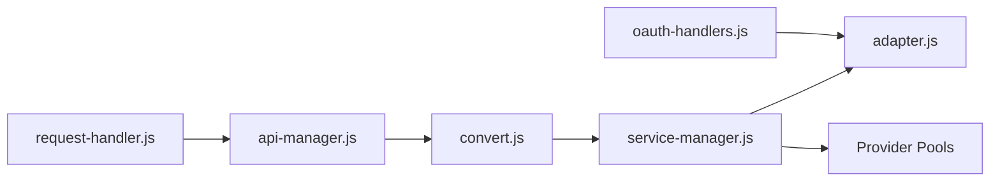

# justlovemaki/AIClient2API

> Local proxy that exposes models reserved for specific clients (Kiro, Codex, Grok, Antigravity) as an OpenAI-compatible API.

## The problem
Tools like Cline or NextChat speak the OpenAI API, whereas some models are only accessible through an official client.

## What it actually does
Node server that converts between OpenAI, Claude and Gemini protocols, routes to per-provider adapters, manages an account pool with failover on error, OAuth tokens, 429 cooldown and TLS fingerprint bypass via a Go sidecar. Web console, full request and response logs, plugins.

## How it is wired


## Trying it
```bash
docker run -d -p 3000:3000 -p 8086:8086 -p 1455:1455 -p 56121:56121 -p 19876-19880:19876-19880 --restart=always -v "your_path/configs:/app/configs" --name aiclient2api justlikemaki/aiclient-2-api
cd docker && mkdir -p configs && docker compose up -d
```

## Cost and gotchas
Default console password `admin123`; OAuth credentials and cookies stored locally; full request logs. The README boasts of bypassing rate limits and Cloudflare blocking by imitating a browser, which may violate the providers' terms and expose your accounts.

## What it is not
Not a model provider. The "99.9% availability" is a README claim, unverified. The README states that use is at your own risk.

## Alternatives
No alternative named in the README.

## For you
Ignore: it relies on circumventing providers' restrictions, with risk of account bans and credential leaks; go through an official API.
