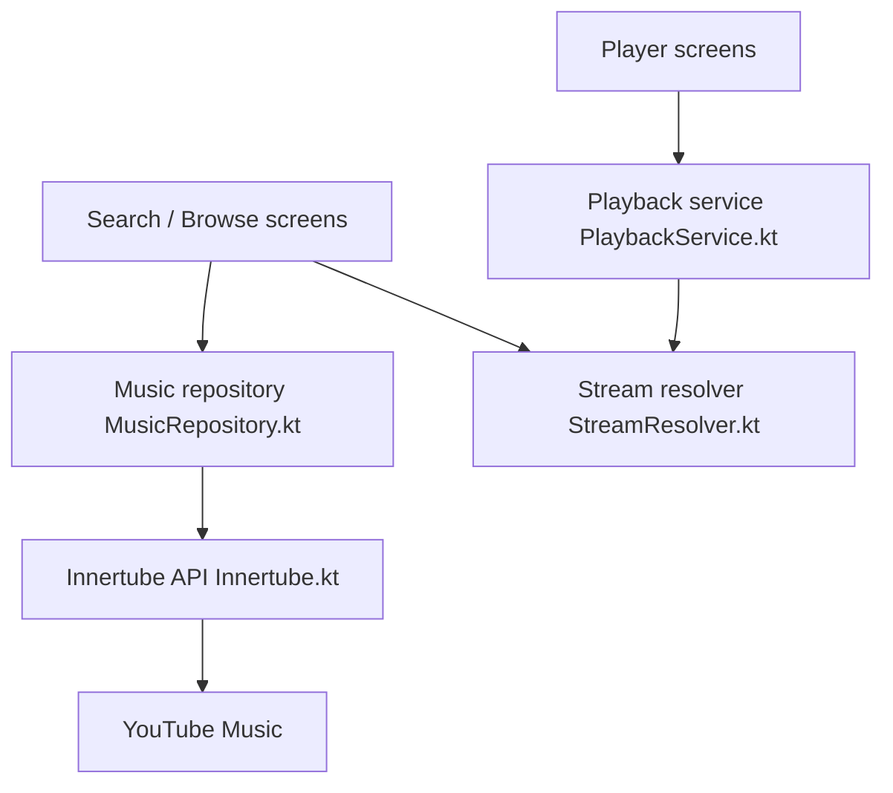

# justshivv/Opentune

> Android music player for YouTube Music that queries YouTube's internal API directly.

## The problem
The official app imposes ads, an account and few audio settings.

## What it actually does
Kotlin application (Compose, Media3) that fetches catalog and streams through the Innertube API, with no key or server of its own. It adds a 15-band equalizer, normalization, synced lyrics, downloads, radio, podcasts, Cast and DLNA streaming, shared listening through a Nostr relay, and scrobbling. Preview variants: TV, Wear OS, desktop, iOS and a web player.

## How it is wired



## Trying it
```bash
./gradlew :desktop:run
```
For the Android app: download the APK from the releases (`arm64-v8a` for most phones). iOS source for SideStore: `https://justshivv.github.io/Opentune/ios/source.json`.

## Cost and gotchas
Free. Using YouTube's internal API is at your own risk regarding the terms of service, and it can break without notice. The README provided is truncated. GPL-3.0 license (copyleft).

## What it is not
Not a universal offline player: it depends on YouTube Music. The iOS version has no sign-in and no equalizer and must be re-signed every 7 days.

## Alternatives
No alternative named in the README.

## For you
Ignore: a hobby app with no link to data or AI.
