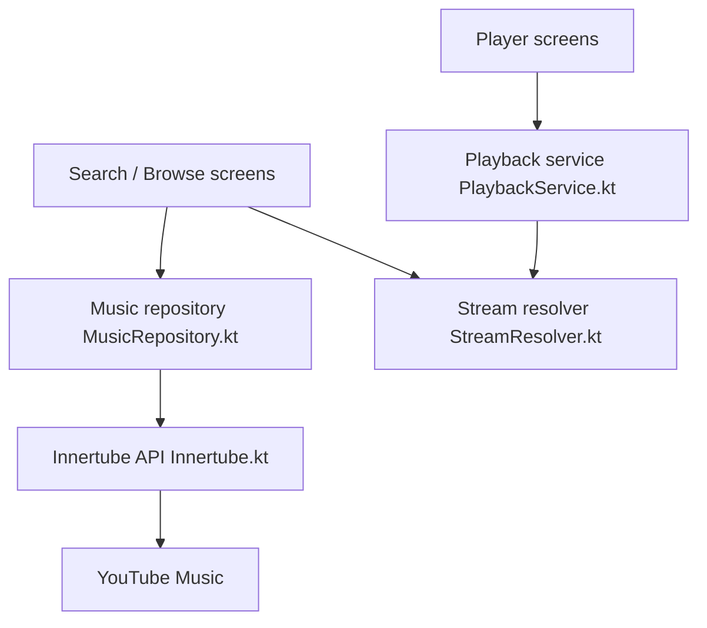

# justshivv/Opentune

> Lecteur de musique Android pour YouTube Music qui interroge directement l'API interne de YouTube.

## Le problème
L'application officielle impose publicité, compte et peu de réglages audio.

## Ce que ça fait vraiment
Application Kotlin (Compose, Media3) qui récupère catalogue et flux via l'API Innertube, sans clé ni serveur propre. Elle ajoute égaliseur 15 bandes, normalisation, paroles synchronisées, téléchargements, radio, podcasts, diffusion Cast et DLNA, écoute partagée par relais Nostr et scrobbling. Variantes en préversion : TV, Wear OS, bureau, iOS et lecteur web.

## Comment c'est branché



## Essayer
```bash
./gradlew :desktop:run
```
Pour l'application Android : télécharger l'APK dans les releases (`arm64-v8a` pour la plupart des téléphones). Source iOS pour SideStore : `https://justshivv.github.io/Opentune/ios/source.json`.

## Coût et pièges
Gratuit. L'usage de l'API interne de YouTube reste à ta charge côté conditions d'utilisation, et peut casser sans préavis. Le README fourni est tronqué. Licence GPL-3.0 (copyleft).

## Ce que ce n'est pas
Pas un lecteur hors ligne universel : il dépend de YouTube Music. La version iOS n'a ni connexion ni égaliseur et doit être re-signée tous les 7 jours.

## Alternatives
Aucune alternative nommée dans le README.

## Pour toi
À ignorer : application de loisir sans lien avec la data ou l'IA.

