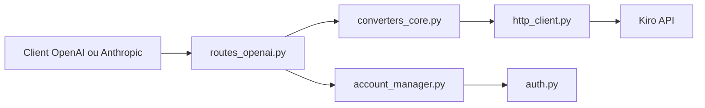

# jwadow/kiro-gateway

> FastAPI proxy exposing Kiro's models through OpenAI- and Anthropic-compatible APIs, for coding tools.

## The problem
The models available through a Kiro (Amazon Q Developer) subscription cannot be plugged directly into Claude Code, Cursor or the OpenAI SDK.

## What it actually does
Translates `/v1/chat/completions` and `/v1/messages` to the Kiro API. Handles SSE streaming, tool calls, vision, web search, retries on 403/429/5xx, token refresh, switching between several accounts and a VPN/SOCKS5 proxy. Credentials come from Kiro IDE, kiro-cli or a refresh token.

## How it is wired


## Trying it
```bash
git clone https://github.com/Jwadow/kiro-gateway.git
cd kiro-gateway
pip install -r requirements.txt
cp .env.example .env
python main.py
```

## Cost and gotchas
A Kiro account is required; the models depend on your tier. The project is not affiliated with AWS, Anthropic or Kiro: risk with regard to terms of use. 103 open issues.

## What it is not
Not a model provider: it only relays your subscription. Last push in May 2026.

## Alternatives
No alternative named in the README.

## For you
Keep an eye on it: handy if you already have Kiro, but it is a diversion of an unofficial third-party service and AGPL; I would not build a professional workflow on it.
