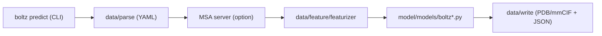

# jwohlwend/boltz

> Family of open models that predict biomolecular structures and binding affinities, under the MIT license.

## The problem
In silico screening of molecules for drug discovery remains slow and costly with physics-based methods (FEP) or closed (AlphaFold3).

## What it actually does
`boltz predict` reads a YAML file describing the biomolecules, optionally fetches MSAs from a server, builds the features, runs the model and writes PDB/mmCIF structures and a summary JSON. Boltz-2 outputs two affinity values: `affinity_probability_binary` to detect binders, `affinity_pred_value` (log10 IC50) for optimization. Training scripts exist for Boltz-1.

## How it is wired


## Trying it
```bash
pip install boltz[cuda] -U
boltz predict input_path --use_msa_server
boltz predict --help
```

## Cost and gotchas
GPU recommended: the CPU version is much slower. `--use_msa_server` sends the sequences to an external server (authentication possible). Boltz-2 evaluation and training code announced as "coming soon".

## What it is not
Not a validated medical product. The claim "1000 times faster than FEP" comes from the authors. 136 open issues.

## Alternatives
- AlphaFold3: the accuracy reference Boltz aims to match, but closed.
- Chai-1: another model compared in their evaluations.

## For you
Adopt it if you work in biology or computational chemistry: weights and code under MIT, installation via pip; otherwise just keep watching.
