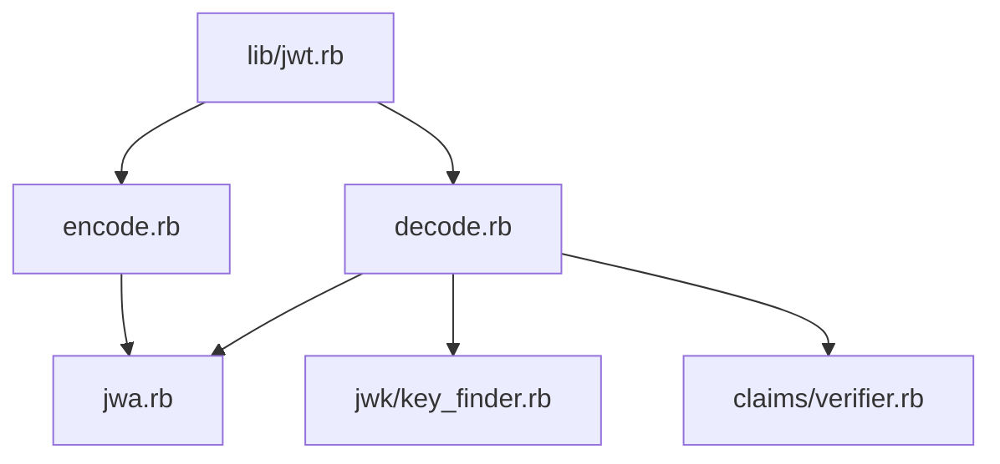

# jwt/ruby-jwt

> Ruby implementation of the JSON Web Token standard (RFC 7519), for Ruby applications that sign and verify tokens.

## The problem
Signing, decoding and validating JWTs by hand exposes you to vulnerabilities, notably around algorithm choice.

## What it actually does
- Encodes and decodes with NONE, HMAC, RSA, ECDSA and RSASSA-PSS via openssl.
- Validates claims (exp, nbf, iss, aud, jti, iat, sub) and required claims.
- Handles JWK keys, JWKS sets and x5c certificates.
- Accepts custom algorithms.

## How it is wired


## Trying it
```bash
gem install jwt
```
```ruby
require 'jwt'
token = JWT.encode({ data: 'test' }, 'my$ecretK3y', 'HS256')
JWT.decode(token, 'my$ecretK3y', true, { algorithm: 'HS256' })
```

## Cost and gotchas
Free. Real requirement: Ruby. Always fix the algorithm when decoding; EdDSA goes through the jwt-eddsa gem since version 3.0.

## What it is not
Not an authentication server nor an OAuth provider: only token handling. End of README truncated.

## Alternatives
No alternative named in the README (jwt-eddsa is an extension).

## For you
Ignore unless you use a Ruby stack: you will find the same notions in your language's JWT library.
