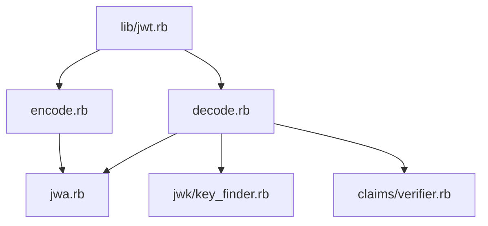

# jwt/ruby-jwt

> Implémentation Ruby du standard JSON Web Token (RFC 7519), pour applications Ruby qui signent et vérifient des jetons.

## Le problème
Signer, décoder et valider correctement des JWT à la main expose à des failles, notamment sur le choix d'algorithme.

## Ce que ça fait vraiment
- Encode et décode avec NONE, HMAC, RSA, ECDSA et RSASSA-PSS via openssl.
- Valide les claims (exp, nbf, iss, aud, jti, iat, sub) et les claims requis.
- Gère les clés JWK, les ensembles JWKS et les certificats x5c.
- Accepte des algorithmes personnalisés.

## Comment c'est branché


## Essayer
```bash
gem install jwt
```
```ruby
require 'jwt'
token = JWT.encode({ data: 'test' }, 'my$ecretK3y', 'HS256')
JWT.decode(token, 'my$ecretK3y', true, { algorithm: 'HS256' })
```

## Coût et pièges
Gratuit. Besoin réel : Ruby. Toujours fixer l'algorithme au décodage ; EdDSA passe par la gem jwt-eddsa depuis la version 3.0.

## Ce que ce n'est pas
Pas un serveur d'authentification ni un fournisseur OAuth : seulement la manipulation de jetons. Fin du README tronquée.

## Alternatives
Aucune alternative nommée dans le README (jwt-eddsa est une extension).

## Pour toi
À ignorer sauf pile Ruby : tu retrouveras les mêmes notions dans la bibliothèque JWT de ton langage.

