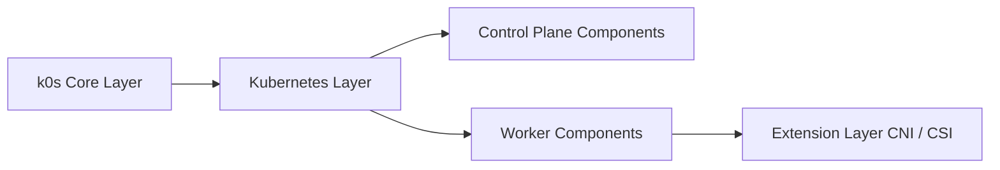

# k0sproject/k0s

> Certified Kubernetes distribution in a single binary, for cloud, bare metal and edge.

## The problem
Installing and maintaining Kubernetes imposes host dependencies, heavy prerequisites and painful lifecycle management.

## What it actually does
Single binary with no host dependency beyond the kernel, 100% upstream Kubernetes.
Single-node or multi-node HA, airgap, Docker; etcd, SQLite, MySQL or PostgreSQL as datastore.
CNI (Kube-Router, Calico), CRI (containerd), CSI; Konnectivity, CoreDNS, Metrics Server included.
Lifecycle (upgrade, backup) via k0sctl; 1 vCPU, 1 GB RAM minimum.

## How it is wired


## Trying it
```bash
make
make EMBEDDED_BINS_BUILDMODE=none
make check-basic
```

## Cost and gotchas
Free; build via Docker. License not identified by GitHub (the README mentions CC-BY-SA for itself).
Few add-ons provided: ingress, mesh, storage must be added yourself.

## What it is not
Not an MLOps platform: just the Kubernetes foundation.
Not "all included": deliberately minimal scope.

## Alternatives
No alternative named in the README.

## For you
Worth watching: a good candidate for a lightweight cluster (edge, lab, CI) hosting your ML services, license to be checked.
