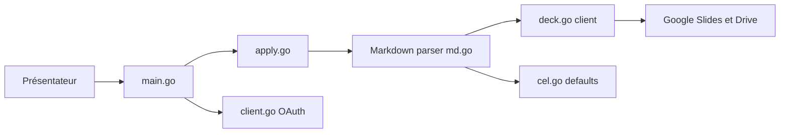

# k1LoW/deck

> Go CLI that generates and updates Google Slides presentations from a Markdown file.

## The problem
Building slides in a graphical editor mixes content and formatting and lends itself poorly to versioning.

## What it actually does
Markdown carries the content, a Google Slides template carries the design. `deck new` creates the presentation, `deck apply` (with `--watch`) pushes changes through the Slides and Drive APIs, `deck export` produces a PDF. It handles layouts through CEL, notes, tables, and can convert code blocks into images.

## How it is wired


## Trying it
```bash
brew install deck
deck doctor
deck new deck.md --title "Talk about deck"
deck apply --watch deck.md
deck open deck.md
```

## Cost and gotchas
A Google Cloud project with OAuth (Slides and Drive APIs) must be created. Images are temporarily uploaded to Drive with public access; organization policies may block this.

## What it is not
Not a design generator: layouts come from your Slides template.

## Alternatives
googleworkspace/md2googleslides, cited in the README.

## For you
Keep an eye on it: handy for producing model-review decks from Markdown (including by an AI agent), if you are on Google Workspace.
