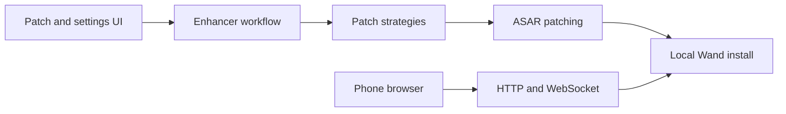

# k1tbyte/Wand-Enhancer

> Windows patcher that locally modifies the Wand client and adds a remote-control web panel.

## The problem
The README talks about "managing the local configuration" and improving the UX of the Wand application, without otherwise describing the targeted product.

## What it actually does
A .NET/WPF tool modifies the files of a local Wand installation (ASAR archive patching), injects JavaScript scripts into the renderer and exposes a web panel on the local network, reachable by QR code from a phone. No official binary: you build it via GitHub Actions in your own fork. The README's warnings target fake tutorial videos that spread malware.

## How it is wired


## Trying it
```bash
build.cmd
build.cmd -EnableUpdateNotifications
```
(Or run the "Build executable" workflow in the Actions tab of your fork.)

## Cost and gotchas
Free. Windows only, Visual Studio 2022, .NET Framework 4.8, Node and pnpm. The unsigned executable triggers antivirus software. The injected scripts run with the same privileges as Wand.

## What it is not
Not a data or AI tool. The panel listens on the local network and the README does not specify its authentication.

## Alternatives
No alternative cited in the README.

## For you
Ignore: a tool for modifying a third-party application, with a risk of impersonation and malware around the name, and unrelated to your field.
