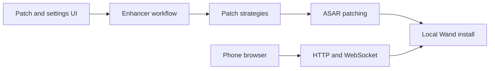

# k1tbyte/Wand-Enhancer

> Patcheur Windows qui modifie localement le client Wand et ajoute un panneau web de contrôle à distance.

## Le problème
Le README parle de « gérer la configuration locale » et d'améliorer l'UX de l'application Wand, sans décrire autrement le produit visé.

## Ce que ça fait vraiment
Un outil .NET/WPF modifie les fichiers d'une installation locale de Wand (patch d'archives ASAR), injecte des scripts JavaScript dans le moteur de rendu et expose un panneau web sur le réseau local, joignable par QR code depuis un téléphone. Pas de binaire officiel : on le compile via GitHub Actions dans son propre fork. Les avertissements du README visent de fausses vidéos de tutoriel qui diffusent des malwares.

## Comment c'est branché


## Essayer
```bash
build.cmd
build.cmd -EnableUpdateNotifications
```
(Ou lancer le workflow « Build executable » dans l'onglet Actions de son fork.)

## Coût et pièges
Gratuit. Windows seulement, Visual Studio 2022, .NET Framework 4.8, Node et pnpm. L'exécutable non signé déclenche les antivirus. Les scripts injectés tournent avec les mêmes droits que Wand.

## Ce que ce n'est pas
Pas un outil de data ou d'IA. Le panneau écoute le réseau local sans que le README n'en précise l'authentification.

## Alternatives
Aucune alternative citée dans le README.

## Pour toi
À ignorer : outil de modification d'une application tierce, avec un risque d'usurpation et de malwares autour du nom, et sans lien avec ton métier.

