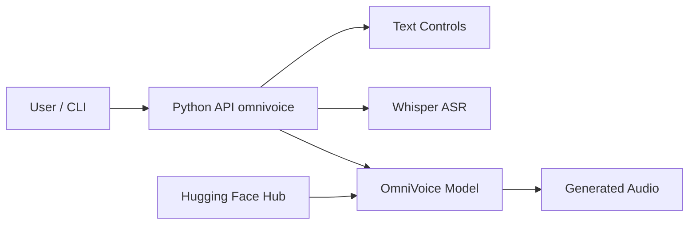

# k2-fsa/OmniVoice

> Zero-shot multilingual text-to-speech model, 600+ languages, with voice cloning and voice design.

## The problem
TTS models cover few languages and often require per-speaker fine-tuning.

## What it actually does
Three modes: cloning from 3 to 10 seconds of reference audio (Whisper transcribes if needed), design by attributes (gender, age, pitch, accent) and automatic voice. Non-verbal tags such as `[laughter]` and pronunciation correction. RTF down to 0.025; FlashInfer speeds it up by 2 to 2.9 times. Training and evaluation (WER, MOS, similarity) included.

## How it is wired


## Trying it
```bash
pip install omnivoice
omnivoice-demo --ip 0.0.0.0 --port 8001
omnivoice-infer --model k2-fsa/OmniVoice --text "This is a test for text to speech." --output hello.wav
```

## Cost and gotchas
NVIDIA GPU, Apple Silicon (mps) or Intel Arc; PyTorch must be installed first. Cross-lingual cloning keeps the accent of the reference. Voice design is only trained on Chinese and English.

## What it is not
The README prohibits unauthorized voice cloning, impersonation and fraud. The most stable mode is cloning, not voice design.

## Alternatives
No alternative cited in the README.

## For you
Adopt: multilingual TTS under Apache-2.0, installable with pip, with a CLI, multi-GPU batching and a training pipeline.
