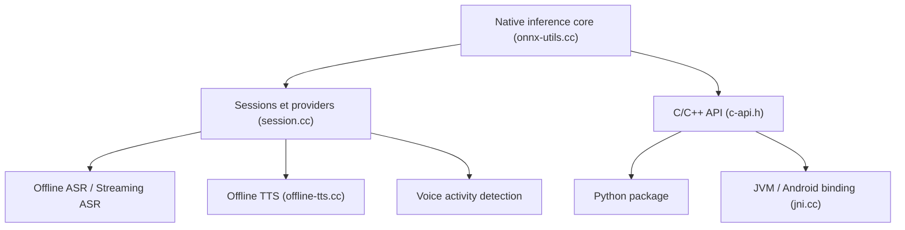

# k2-fsa/sherpa-onnx

> Local speech recognition and synthesis library on ONNX, for a very wide range of platforms.

## The problem
Integrating speech (transcription, synthesis) without the cloud, including on mobile, embedded devices or in the browser.

## What it actually does
Offline or streaming features: speech recognition, synthesis, diarization, speaker identification and verification, voice activity detection, keyword spotting, audio tagging, enhancement and source separation. C++ core on ONNX Runtime, with C, Python, Java/Kotlin, Go, C#, Swift, Rust, Dart and JavaScript APIs. Targets: Linux, macOS, Windows, Android, iOS, WebAssembly, Raspberry Pi, Rockchip and Ascend NPUs. Pretrained models are distributed separately.

## How it is wired

## Trying it
No installation command in the README excerpt provided; it points to the documentation (https://k2-fsa.github.io/sherpa/onnx/), to online Hugging Face spaces, and to prebuilt APKs and Flutter apps.

## Cost and gotchas
Free. Models must be downloaded separately; size varies (a cited Qwen3-ASR model is about 1 GB). Compilation is required for some platforms (iOS in particular).

## What it is not
Not an application: it is an engine to integrate. The README mostly describes targets and user projects; detailed documentation is elsewhere.

## Alternatives
Whisper, Moonshine, Piper and Silero-VAD are models usable inside the project, not competitors.

## For you
Adopt: a reference for 100% local, portable speech, to be evaluated according to the language and model chosen.
