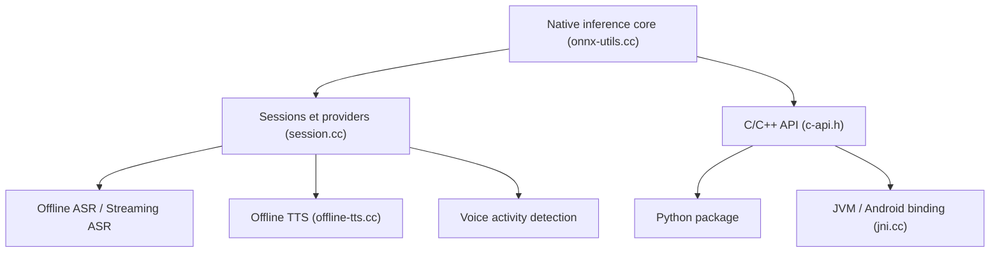

# k2-fsa/sherpa-onnx

> Bibliothèque locale de reconnaissance et synthèse vocale sur ONNX, pour de très nombreuses plateformes.

## Le problème
Intégrer de la parole (transcription, synthèse) sans cloud, y compris sur mobile, embarqué ou navigateur.

## Ce que ça fait vraiment
Fonctions hors ligne ou en flux : reconnaissance vocale, synthèse, diarisation, identification et vérification du locuteur, détection d'activité vocale, mots-clés, étiquetage audio, amélioration et séparation de sources. Cœur en C++ sur ONNX Runtime, avec API C, Python, Java/Kotlin, Go, C#, Swift, Rust, Dart et JavaScript. Cibles : Linux, macOS, Windows, Android, iOS, WebAssembly, Raspberry Pi, NPU Rockchip et Ascend. Modèles préentraînés distribués séparément.

## Comment c'est branché

## Essayer
Aucune commande d'installation dans l'extrait du README fourni ; il renvoie à la documentation (https://k2-fsa.github.io/sherpa/onnx/), à des espaces Hugging Face en ligne, à des APK et applications Flutter précompilés.

## Coût et pièges
Gratuit. Les modèles sont à télécharger à part ; la taille varie (un modèle Qwen3-ASR cité fait environ 1 Go). Compilation requise pour certaines plateformes (iOS notamment).

## Ce que ce n'est pas
Pas une application : c'est un moteur à intégrer. Le README décrit surtout des cibles et projets utilisateurs, la documentation détaillée est ailleurs.

## Alternatives
Whisper, Moonshine, Piper et Silero-VAD sont des modèles utilisables à l'intérieur du projet, pas des concurrents.

## Pour toi
À adopter : référence pour de la parole 100 % locale et portable, à évaluer selon la langue et le modèle choisi.

