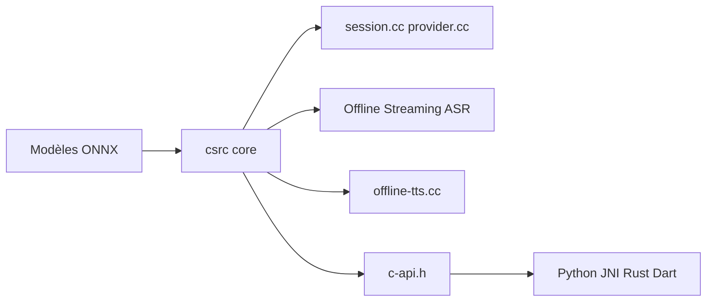

# k2-fsa/sherpa-onnx

> Reconnaissance vocale, synthèse, VAD et diarisation hors ligne via ONNX, sur de nombreuses plateformes.

## Le problème
Faire de la parole (ASR, TTS) en local, sur mobile, embarqué ou navigateur, sans cloud.

## Ce que ça fait vraiment
Noyau C++ au-dessus d'ONNX Runtime : ASR en flux et hors ligne, TTS, VAD, mots-clés, diarisation, identification de locuteur, rehaussement, séparation de sources. Une API C sert de contrat, avec liaisons Python, Java/Kotlin, Rust, Node, WASM, Flutter, Swift, Go, C#. Accélérateurs : CUDA, QNN, RKNN, Ascend.

## Comment c'est branché

## Essayer
Le README fourni est tronqué en tête (début manquant) et ne contient aucune commande d'installation : il renvoie vers Hugging Face Spaces, APK précompilés et la documentation https://k2-fsa.github.io/sherpa/onnx/.

## Coût et pièges
Gratuit. Les modèles se téléchargent séparément (releases du dépôt), parfois de l'ordre du Go.

## Ce que ce n'est pas
Pas une application finie : une bibliothèque et des démos. Pas d'API cloud.

## Alternatives
Whisper et Moonshine sont des modèles cités, utilisables via sherpa-onnx plutôt que concurrents.

## Pour toi
Adopter pour de la voix locale ou embarquée : large couverture de modèles et de langages, Apache-2.0, activité forte.

