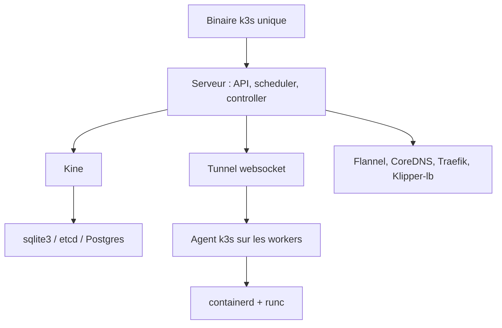

# k3s-io/k3s

> Conformant Kubernetes distribution in a single binary under 100 MB, for edge, IoT and CI.

## The problem
A full Kubernetes needs etcd, several components, a memory footprint and an operator who knows all of it.
On an edge device, a CI machine or a dev workstation, the cost/benefit ratio does not hold.

## What it actually does
A fully conformant Kubernetes distribution, packaged as a single binary, with sqlite3 as the default storage backend (etcd3, MariaDB, MySQL and Postgres remain possible).
Reduced memory footprint by running many components in a single process; in-tree storage drivers and cloud providers are removed, replaceable by CSI and CCM.
Bundles containerd and runc, Flannel, CoreDNS, Metrics Server, Traefik, Klipper-lb, kube-router netpol, helm-controller, Kine, local-path-provisioner — all of which can be disabled or replaced.
Manages component TLS certificates, the worker/server link through a websocket tunnel, automatic deployment of local manifests and an embedded etcd.

## How it is wired


## Trying it
```bash
curl -sfL https://get.k3s.io | sh -
sudo kubectl get nodes
curl -sfL https://get.k3s.io | K3S_URL=https://myserver:6443 K3S_TOKEN=XXX sh -
```

## Cost and gotchas
Free, with no heavy OS dependency (a decent kernel and cgroup mounts are enough).
Installing with `curl | sh` writes a systemd/openrc service and drops `kubectl`, `crictl`, `k3s-killall.sh`, `k3s-uninstall.sh`: read it before running.

## What it is not
It is not a fork of Kubernetes: the README insists on this, it is a distribution, with fewer than 1,000 lines of patches and a goal of staying close to upstream.
It is not a functionally lightened Kubernetes: only the in-tree storage drivers and cloud providers were removed.
It is not free of imposed choices: ingress, CNI, network policy and service load balancer are opinionated decisions, to be undone if they do not suit you.

## Alternatives
No competing distribution is named in the README.

## For you
The right Kubernetes for a lab, a CI or an edge model deployment: conformant, without the operational tax.
