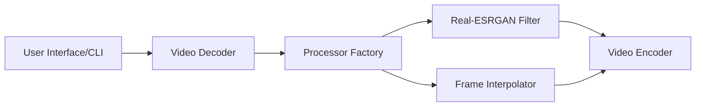

# k4yt3x/video2x

> Machine-learning video super-resolution and frame interpolation tool, with a Windows GUI and a CLI.

## The problem
Upscaling a low-definition video or increasing its smoothness without having to build an ML pipeline yourself.

## What it actually does
C/C++ rewrite: decodes, filters (Anime4K, Real-ESRGAN, Real-CUGAN) or interpolates (RIFE), re-encodes. Inference via ncnn and Vulkan, with no intermediate disk copy. Windows installer, Arch packages, AppImage, container image, Colab notebook.

## How it is wired

## Trying it
No command in the README: Windows installer, Linux AppImage, Docker/Podman image ("a single command", not reproduced) or Colab.

## Cost and gotchas
A Vulkan-compatible GPU and an AVX2 CPU are mandatory. Free Colab is limited to 12 hours, with a risk of ban if abused.

## What it is not
Not a training tool: it applies existing models. The README demos are flagged as outdated.

## Alternatives
None named as an alternative in the README.

## For you
Keep an eye on it: handy for testing upscaling models on a local GPU, but purely application-level, with no direct MLOps interest.
