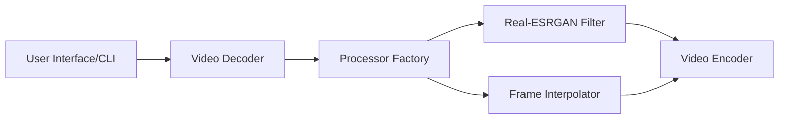

# k4yt3x/video2x

> Outil de super-résolution et d'interpolation d'images vidéo par apprentissage, avec GUI Windows et CLI.

## Le problème
Agrandir une vidéo basse définition ou augmenter sa fluidité sans pipeline ML à monter soi-même.

## Ce que ça fait vraiment
Réécriture C/C++ : décode, filtre (Anime4K, Real-ESRGAN, Real-CUGAN) ou interpole (RIFE), ré-encode. Inférence via ncnn et Vulkan, sans copie disque intermédiaire. Installeur Windows, paquets Arch, AppImage, image conteneur, notebook Colab.

## Comment c'est branché

## Essayer
Aucune commande dans le README : installeur Windows, AppImage Linux, image Docker/Podman (« une seule commande », non reproduite) ou Colab.

## Coût et pièges
GPU compatible Vulkan et CPU AVX2 obligatoires. Colab gratuit limité à 12 h, risque de bannissement si abusé.

## Ce que ce n'est pas
Pas un outil d'entraînement : il applique des modèles existants. Les démos du README sont signalées obsolètes.

## Alternatives
Aucune nommée comme alternative dans le README.

## Pour toi
Surveiller : pratique pour tester des modèles d'upscaling sur GPU local, mais purement applicatif, sans intérêt MLOps direct.

