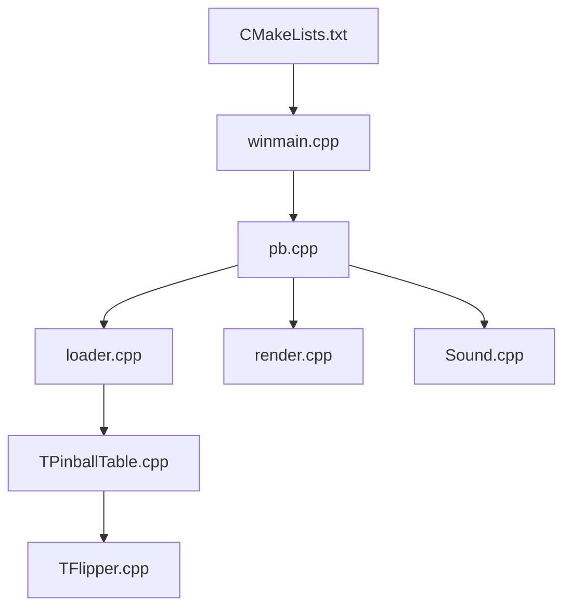

# k4zmu2a/SpaceCadetPinball

> Reverse engineering of the Windows Space Cadet pinball game, ported to Windows, Linux and macOS with SDL2.

## The problem
The game bundled with Windows no longer runs on recent systems, nor anywhere other than Windows.

## What it actually does
The code was decompiled from Windows XP's `pinball.exe` with Ghidra and IDA, named, then converted into compilable C++. The port uses SDL2 and ImGui, with a resizable window and high-resolution sprites. The original resources are not provided and must be placed next to the executable. Many third-party ports exist.

## How it is wired


## Trying it
```bash
brew tap draftbrew/tap
brew install --no-quarantine space-cadet-pinball
```

## Cost and gotchas
You must own the original game files. Build with CMake and SDL2, SDL2_mixer. Last push in August 2024. The Homebrew formula disables Gatekeeper at install.

## What it is not
Not a new game: a reconstruction of the original code, whose legal side depends on the resources you supply.

## Alternatives
No alternative named in the README.

## For you
Ignore: a reverse-engineering curiosity, unrelated to your data or AI work.
