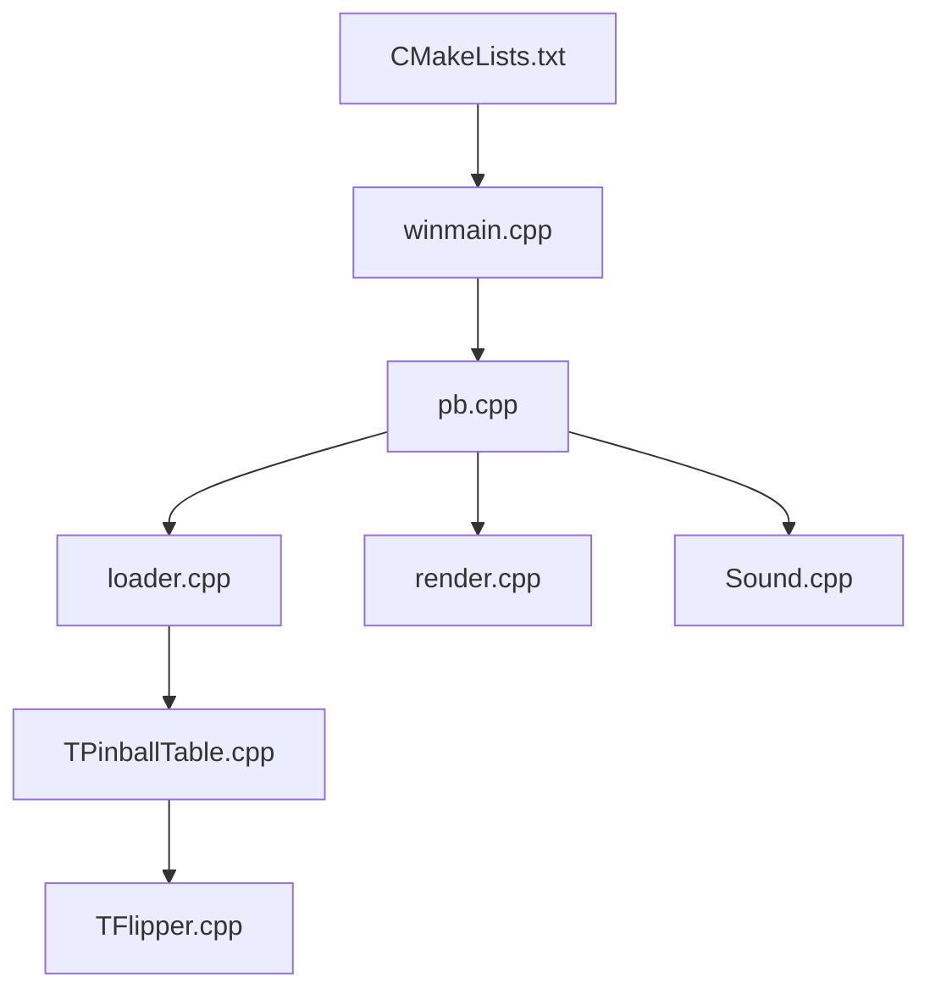

# k4zmu2a/SpaceCadetPinball

> Rétro-ingénierie du flipper Space Cadet de Windows, portée sur Windows, Linux et macOS avec SDL2.

## Le problème
Le jeu fourni avec Windows ne tourne plus sur les systèmes récents ni ailleurs qu'à Windows.

## Ce que ça fait vraiment
Le code a été décompilé depuis `pinball.exe` de Windows XP avec Ghidra et IDA, nommé, puis converti en C++ compilable. Le port utilise SDL2 et ImGui, avec fenêtre redimensionnable et sprites haute résolution. Les ressources d'origine ne sont pas fournies et doivent être placées à côté de l'exécutable. Il existe de nombreux portages tiers.

## Comment c'est branché


## Essayer
```bash
brew tap draftbrew/tap
brew install --no-quarantine space-cadet-pinball
```

## Coût et pièges
Il faut posséder les fichiers du jeu original. Compilation avec CMake et SDL2, SDL2_mixer. Dernier push en août 2024. Le Homebrew désactive Gatekeeper à l'installation.

## Ce que ce n'est pas
Pas un nouveau jeu : une reconstruction du code d'origine, dont la partie légale dépend des ressources que tu fournis.

## Alternatives
Aucune alternative nommée dans le README.

## Pour toi
Ignorer : curiosité de rétro-ingénierie, sans lien avec ton travail data ou IA.

