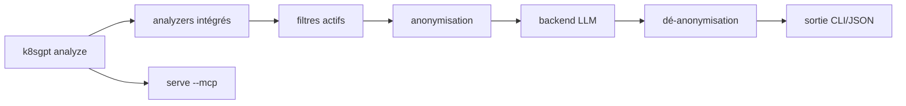

# k8sgpt-ai/k8sgpt

> Scans a Kubernetes cluster, diagnoses problems and explains them in plain language.

## The problem
Reading `kubectl describe` on twenty resources to understand why a pod does not start requires SRE experience that not everyone has.

## What it actually does
Built-in analyzers (pod, service, ingress, deployment, job, node, webhooks, HPA, PDB, NetworkPolicy, Gateway API, security, logs, storage…) that sort and extract the relevant information.
`--explain` enriches the diagnosis with an LLM; `--with-doc` adds the official Kubernetes documentation to it.
Anonymization: names and labels are masked before being sent to the backend and restored in the response.
MCP server (`k8sgpt serve --mcp`) exposing 12 tools, 3 resources and 3 prompts for Claude Desktop and other clients.

## How it is wired


## Trying it
```sh
brew install k8sgpt
k8sgpt generate
k8sgpt auth add
k8sgpt analyze --explain --with-doc
k8sgpt serve --mcp --mcp-http --mcp-port 8089
```

## Cost and gotchas
The default backend is OpenAI: key at your own expense. The configuration, **key included**, is stored in plain text in `k8sgpt.yaml`. Anonymization does not cover events, nor the Describe fields, ObjectStatus and event messages — a project name can leak through there.

## What it is not
Not a remediation tool: it diagnoses and suggests. Not safe by default in sensitive production: the team itself recommends a local model in critical environments. The MCP server has no network protection of its own.

## Alternatives
`k8sgpt-operator` for continuous monitoring inside the cluster, and LiteLLM to route to 100+ providers — two cited complements, not competitors.

## For you
Very useful day to day, provided you plug it into a local model or LiteLLM rather than OpenAI.
