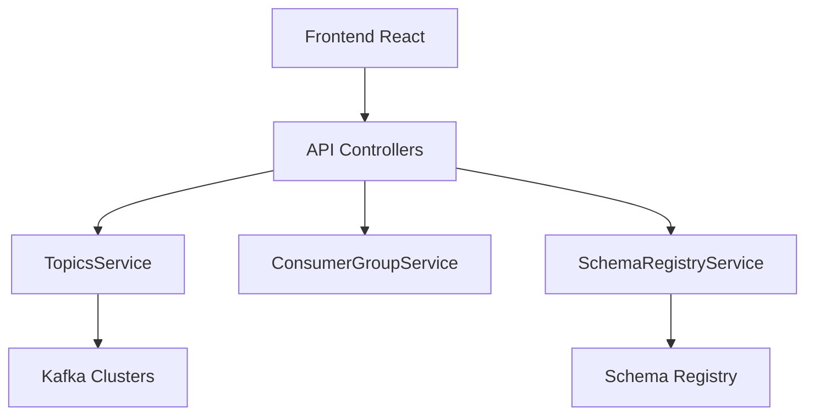

# kafbat/kafka-ui

> Web interface to monitor and administer Apache Kafka clusters: topics, consumers, messages.

## The problem
Inspecting a topic, a consumer group's lag or a schema from the command line is slow and hard to read.

## What it actually does
Multi-cluster dashboard: brokers, topics, partitions, consumer groups and lag, message browser (JSON, text, Avro, CEL filters), topic creation, schema registry, connectors. OAuth 2.0, LDAP or basic authentication, RBAC, data masking, custom serdes, MCP server. Spring WebFlux backend, React frontend.

## How it is wired
Diagram based on the code's diagram.



## Trying it
```bash
docker run -it -p 8080:8080 -e DYNAMIC_CONFIG_ENABLED=true -e SWAGGER_UI_ENABLED=true ghcr.io/kafbat/kafka-ui
# puis http://localhost:8080
```

## Cost and gotchas
Free, Docker. You need a Kafka cluster to connect to. To persist the configuration, mount a `dynamic_config.yaml` file. 331 open issues.

## What it is not
Not a full monitoring tool: metrics remain light. It does not replace Prometheus or Grafana.

## Alternatives
Provectus kafka-ui, whose legacy it continues (cited in the README).

## For you
Adopt if you do data streaming with Kafka: immediate gain for inspecting topics and lag.
