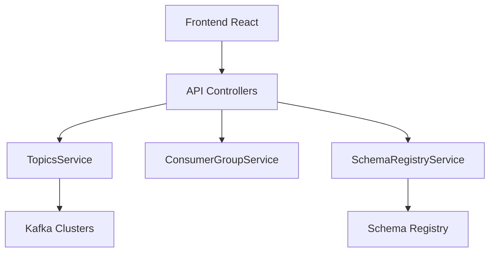

# kafbat/kafka-ui

> Interface web pour surveiller et administrer des clusters Apache Kafka : topics, consommateurs, messages.

## Le problème
Inspecter un topic, le retard d'un groupe de consommateurs ou un schéma en ligne de commande est lent et peu lisible.

## Ce que ça fait vraiment
Tableau de bord multi-clusters : brokers, topics, partitions, groupes de consommateurs et retards, navigateur de messages (JSON, texte, Avro, filtres CEL), création de topics, registre de schémas, connecteurs. Authentification OAuth 2.0, LDAP ou basique, RBAC, masquage de données, serdes personnalisés, serveur MCP. Backend Spring WebFlux, frontend React.

## Comment c'est branché
Schéma d'après le diagramme du code.



## Essayer
```bash
docker run -it -p 8080:8080 -e DYNAMIC_CONFIG_ENABLED=true -e SWAGGER_UI_ENABLED=true ghcr.io/kafbat/kafka-ui
# puis http://localhost:8080
```

## Coût et pièges
Gratuit, Docker. Il faut un cluster Kafka à brancher. Pour persister la configuration, monter un fichier `dynamic_config.yaml`. 331 issues ouvertes.

## Ce que ce n'est pas
Pas un outil de supervision complet : les métriques restent légères. Il ne remplace pas un Prometheus ou Grafana.

## Alternatives
Provectus kafka-ui, dont il poursuit l'héritage (cité dans le README).

## Pour toi
À adopter si tu fais du streaming de données avec Kafka : gain immédiat pour inspecter topics et retards.

