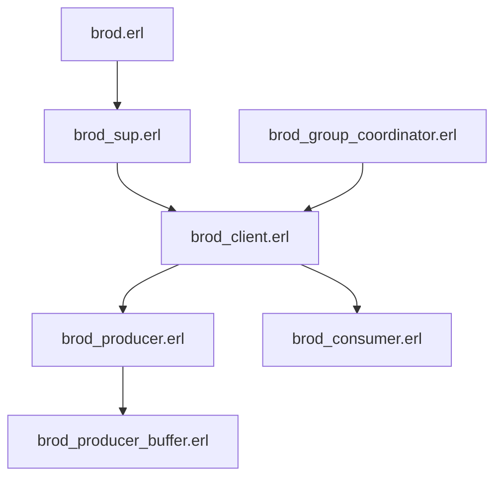

# kafka4beam/brod

> Apache Kafka client for Erlang and Elixir, producers and consumers, for BEAM platform developers.

## The problem
Talking to a Kafka cluster from Erlang or Elixir requires implementing the protocol, recovery after leader election and consumer groups.

## What it actually does
A `brod_client` maintains the sockets to the brokers and supervises one producer and one consumer per partition. Producers batch messages and retry on leader errors. It offers topic and group subscribers, direct cluster inspection APIs and a command-line tool.

## How it is wired


## Trying it
```bash
make compile
make test-env t   # requires docker-compose in place
```

## Cost and gotchas
Free, but a reachable Kafka broker is required. Build: Erlang/OTP 24 minimum and CMake 4 for the crc32cer NIF; tests require docker-compose. No compression by default.

## What it is not
Neither a broker, nor a client for Python or Java. Old Kafka 0.9 requires `query_api_versions` set to false.

## Alternatives
No alternative named in the README.

## For you
Ignore unless your streaming pipeline is in Elixir or Erlang: it is a very mature client, but in an ecosystem outside the usual Python.
