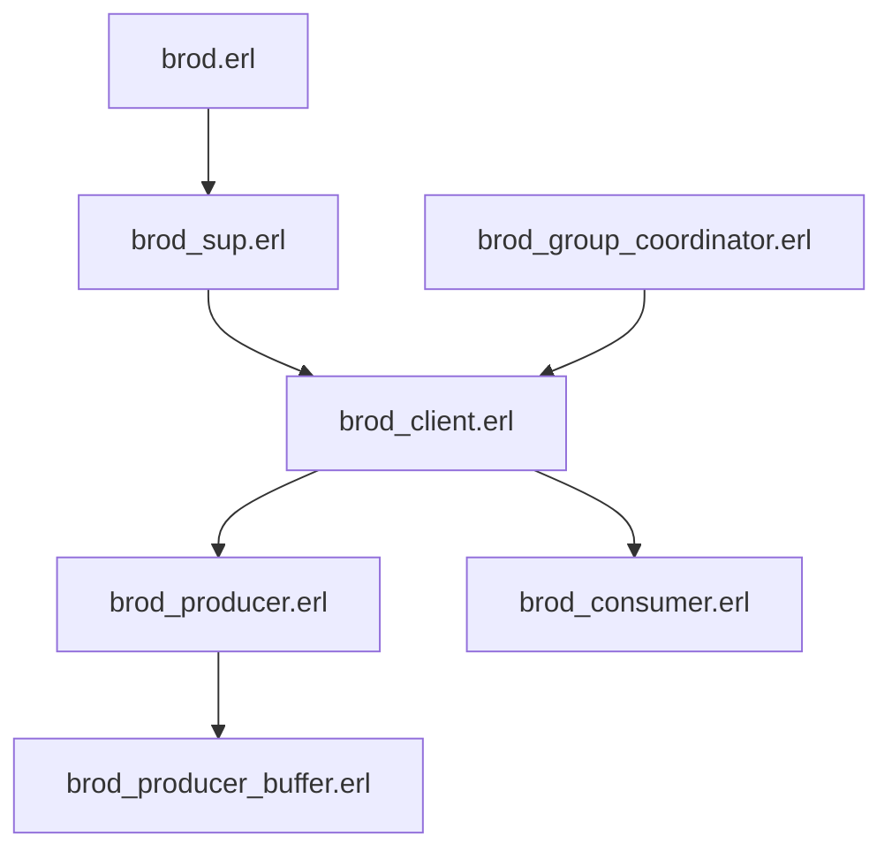

# kafka4beam/brod

> Client Apache Kafka pour Erlang et Elixir, producteurs et consommateurs, pour développeurs de la plateforme BEAM.

## Le problème
Parler à un cluster Kafka depuis Erlang ou Elixir exige d'implémenter le protocole, la reprise après élection de leader et les groupes de consommateurs.

## Ce que ça fait vraiment
Un `brod_client` maintient les sockets vers les brokers et supervise un producteur et un consommateur par partition. Les producteurs regroupent les messages en lots et réessaient sur les erreurs de leader. Il propose abonnés de topic et de groupe, API directes d'inspection du cluster et un outil en ligne de commande.

## Comment c'est branché


## Essayer
```bash
make compile
make test-env t   # requires docker-compose in place
```

## Coût et pièges
Gratuit, mais il faut un broker Kafka joignable. Compilation : Erlang/OTP 24 minimum et CMake 4 pour le NIF crc32cer ; les tests demandent docker-compose. Aucune compression par défaut.

## Ce que ce n'est pas
Ni un broker, ni un client pour Python ou Java. Les anciens Kafka 0.9 demandent `query_api_versions` à false.

## Alternatives
Aucune alternative nommée dans le README.

## Pour toi
À ignorer sauf si ton pipeline de streaming est en Elixir ou Erlang : c'est un client très mûr, mais dans un écosystème hors du Python habituel.

