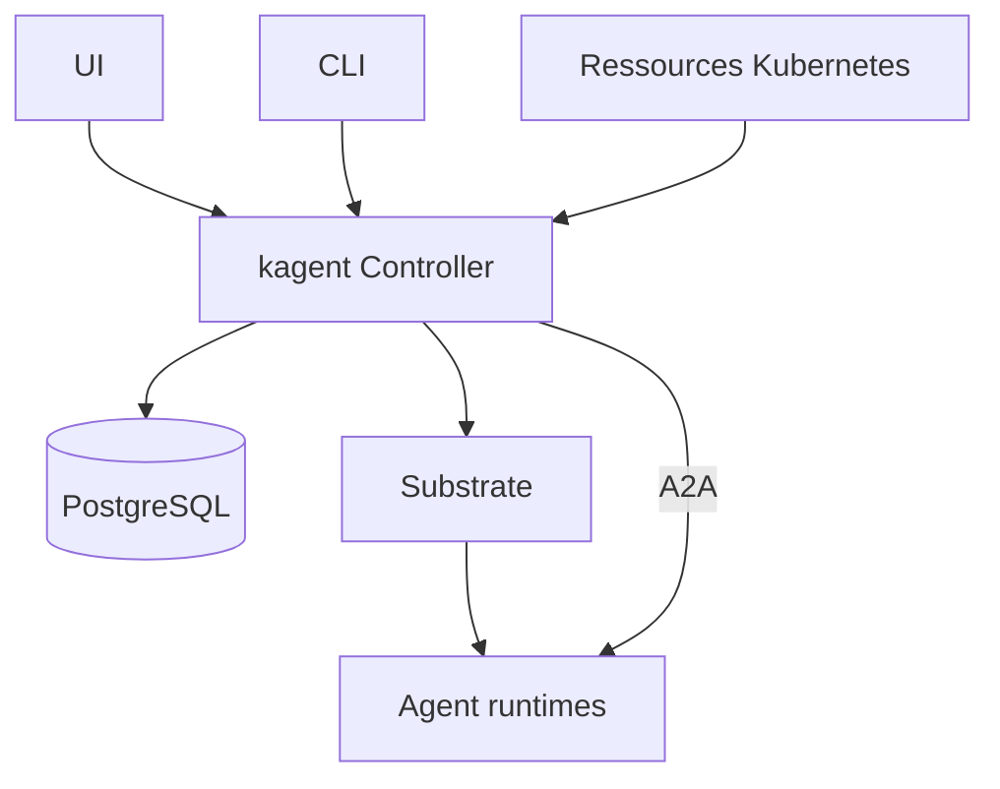

# kagent-dev/kagent

> Kubernetes-native framework to build, deploy and manage AI agents described as declarative resources.

## The problem
AI agents often run as isolated scripts, with no lifecycle, no session tracking and no GitOps deployment.

## What it actually does
An agent is a Kubernetes resource (Agent, ModelConfig, RemoteMCPServer, AgentTemplate). A Go controller watches these resources, prepares the agents and manages sessions, with gRPC, A2A and MCP APIs. Agents run through runtimes (ADK Go or Python, Codex, Claude, custom), store sessions and history in PostgreSQL, and are traced with OpenTelemetry. A web interface and a CLI complete the whole.

## How it is wired

## Trying it
No command documented in the README: it points to the installation guide and to creating a first agent.

## Cost and gotchas
Free, but you need a Kubernetes cluster, PostgreSQL and at least one LLM provider (OpenAI, Azure OpenAI, Anthropic, Vertex AI, Ollama…) whose usage is billed to you.

## What it is not
Not an agent library to import into a script: it is a platform that assumes Kubernetes. It does not provide a model.

## Alternatives
No alternative cited in the README.

## For you
Worth watching if your team already deploys everything on Kubernetes and wants to manage its agents with GitOps; otherwise the operating burden is disproportionate.
