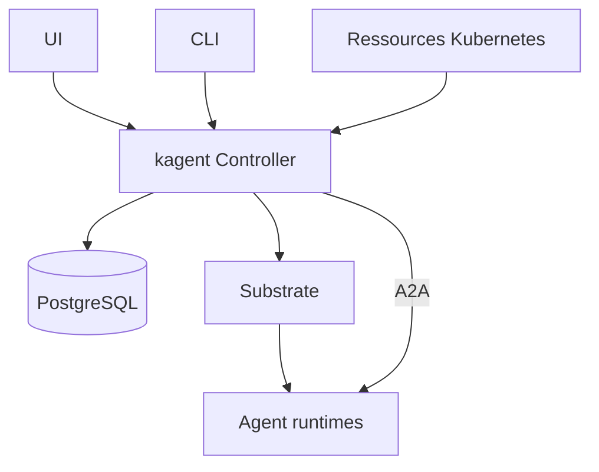

# kagent-dev/kagent

> Framework natif Kubernetes pour construire, déployer et gérer des agents IA décrits comme ressources déclaratives.

## Le problème
Les agents IA tournent souvent comme des scripts isolés, sans cycle de vie, sans suivi de sessions ni déploiement GitOps.

## Ce que ça fait vraiment
Un agent est une ressource Kubernetes (Agent, ModelConfig, RemoteMCPServer, AgentTemplate). Un contrôleur Go surveille ces ressources, prépare les agents et gère les sessions, avec des API gRPC, A2A et MCP. Les agents s'exécutent via des runtimes (ADK Go ou Python, Codex, Claude, personnalisé), stockent sessions et historique dans PostgreSQL, et se tracent avec OpenTelemetry. Une interface web et une CLI complètent l'ensemble.

## Comment c'est branché

## Essayer
Aucune commande documentée dans le README : il renvoie au guide d'installation et à la création d'un premier agent.

## Coût et pièges
Gratuit, mais il faut un cluster Kubernetes, PostgreSQL et au moins un fournisseur de LLM (OpenAI, Azure OpenAI, Anthropic, Vertex AI, Ollama…) dont l'usage est facturé chez toi.

## Ce que ce n'est pas
Pas une bibliothèque d'agents à importer dans un script : c'est une plateforme qui suppose Kubernetes. Il ne fournit pas de modèle.

## Alternatives
Aucune alternative citée dans le README.

## Pour toi
À surveiller si ton équipe déploie déjà tout sur Kubernetes et veut gérer ses agents en GitOps ; sinon la charge d'exploitation est disproportionnée.

