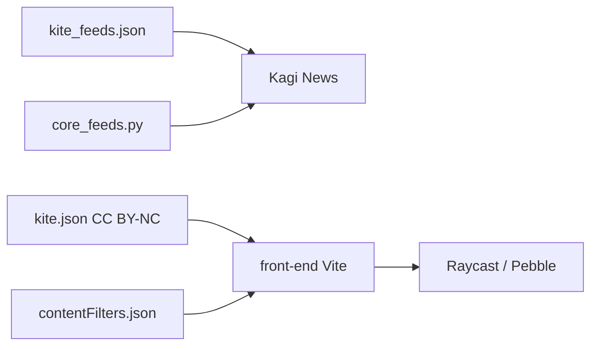

# kagisearch/kite-public

> Web front-end and open data of Kagi News, a daily news feed with no ads and no tracking.

## The problem
News feeds push toward endless scrolling and noise. Kagi News offers one update per day, without opinion.

## What it actually does
Repository of the front-end (Vite, Node LTS) and community data files: categories by RSS feed (kite_feeds.json, 25 feeds minimum), the core_feeds.py base feeds, media info (media_data.json) and multilingual content filters. The contents of kite.kagi.com/kite.json are under CC BY-NC. The beginning of the README is truncated.

## How it is wired


## Trying it
```bash
git clone https://github.com/kagisearch/kite-public.git
cd kite-public
node -v
npm install
npm run dev
```

## Cost and gotchas
Free as code. The kite.json data is non-commercial: commercial use requires a license via Kagi support. News processing stays on the Kagi side, outside the repository.

## What it is not
Not the summarization engine: only the front-end and feed lists are open. No commercial license for the data.

## Alternatives
No alternative named in the README.

## For you
Watch: interesting as a front-end and as a source of classified RSS feeds, but dependent on Kagi data under a non-commercial license.
