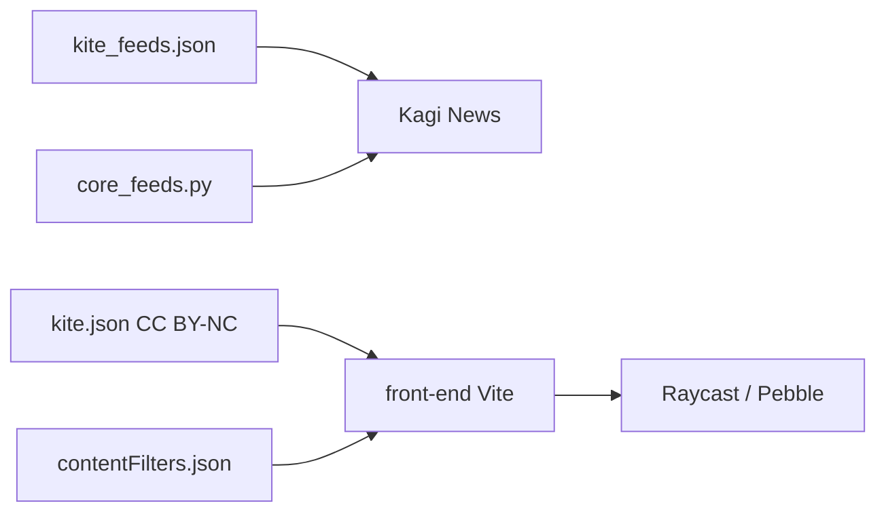

# kagisearch/kite-public

> Front-end web et données ouvertes de Kagi News, un fil d'actualité quotidien sans pub ni pistage.

## Le problème
Les flux d'actualité poussent au défilement sans fin et au bruit. Kagi News propose une mise à jour par jour, sans opinion.

## Ce que ça fait vraiment
Dépôt du front-end (Vite, Node LTS) et de fichiers de données communautaires : catégories par flux RSS (kite_feeds.json, 25 flux minimum), flux de base core_feeds.py, infos médias (media_data.json) et filtres de contenu multilingues. Les contenus de kite.kagi.com/kite.json sont sous CC BY-NC. Le début du README est tronqué.

## Comment c'est branché


## Essayer
```bash
git clone https://github.com/kagisearch/kite-public.git
cd kite-public
node -v
npm install
npm run dev
```

## Coût et pièges
Gratuit en code. Les données kite.json sont non commerciales : usage commercial sur licence via support Kagi. Le traitement des actualités reste côté Kagi, hors dépôt.

## Ce que ce n'est pas
Pas le moteur de synthèse : seul le front-end et des listes de flux sont ouverts. Pas de licence commerciale pour les données.

## Alternatives
Aucune alternative nommée dans le README.

## Pour toi
Surveiller : intéressant comme front-end et source de flux RSS classés, mais dépendant des données Kagi sous licence non commerciale.

