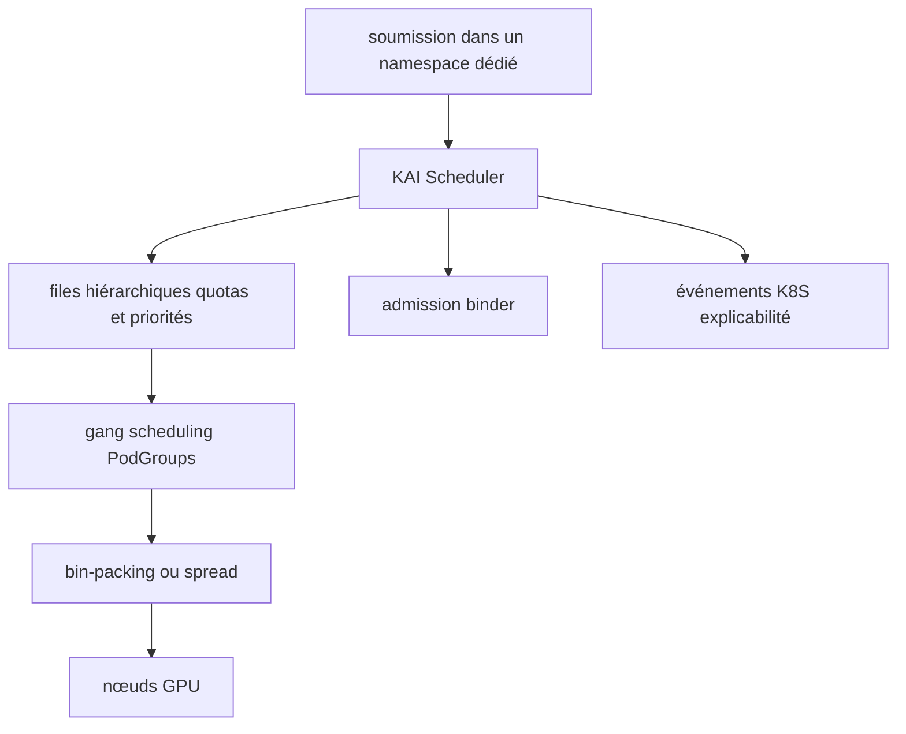

# kai-scheduler/KAI-Scheduler

> Kubernetes scheduler that distributes GPUs across hierarchical queues for AI workloads.

## The problem
The default Kubernetes scheduler can neither guarantee that a group of pods starts together, nor fairly arbitrate GPUs between teams.
On a shared cluster, a large training job and an interactive notebook compete for the same cards with no common policy.

## What it actually does
Does gang scheduling: all pods of a group start, or none. Manages hierarchical PodGroups for distributed and disaggregated workloads.
Applies quotas, limits, over-quota weights and priorities per queue, with DRF fairness, history-aware time sharing, and a guaranteed minimum duration before preemption.
Separates priority and preemptibility into two independent policies; consolidates running workloads to reduce fragmentation.
Shares one or several GPUs between workloads, handles DRA (NVIDIA/AMD ResourceClaims, GB200/GB300) and topology-aware scheduling.

## How it is wired


## Trying it
```sh
helm upgrade -i kai-scheduler oci://ghcr.io/kai-scheduler/kai-scheduler/kai-scheduler -n kai-scheduler --create-namespace --version <VERSION>
```

## Cost and gotchas
A Kubernetes cluster, Helm and the NVIDIA GPU-Operator are required for GPU workloads.
On OpenShift with a gpu-operator older than v25.10.0, add `--set-string admission.gpuFractionRuntimeClassName=""` — never `null`.
Never submit a workload in the `kai-scheduler` namespace itself.

## What it is not
Not a mandatory replacement: it coexists with other schedulers installed on the cluster.
Not a brand-new product from scratch: it is built from kube-batch.
Not a single-machine solution: without a cluster or GPU-Operator, there is nothing to schedule.

## Alternatives
- kube-batch: the base KAI derives from, simpler if only gang scheduling is needed.

## For you
Relevant the day you share a GPU cluster between several teams; useless on a single machine.
