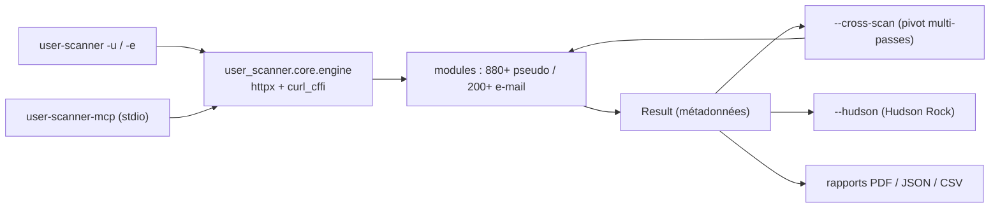

# kaifcodec/user-scanner

> Command-line OSINT suite to check for the presence of an email or a username.

## The problem
Checking on which platforms a username or an address is registered otherwise means going
platform by platform, by hand, with no usable trace.

## What it actually does
Queries more than 1,080 vectors — 200+ sites for email, 880+ platforms for username — and
retrieves the public metadata exposed (avatars, bios, follower counts, UIDs, statuses). The
`--cross-scan` pivot engine extracts handles, profile links and exposed addresses from the first
results, then launches further passes on these new vectors, with adjustable depth
(`--cross-depth`). `--hudson` queries Hudson Rock's infostealer compromise logs.
Parallelism via `httpx` and `curl_cffi` with TLS fingerprint spoofing, proxy rotation with
protocol detection and prior validation, a username permutation generator, PDF (with photos),
JSON and CSV exports, and an stdio MCP server exposing `scan_username`, `scan_email` and
`list_available_modules`.

## How it is wired


## Trying it
```bash
python3 -m pip install --upgrade pip
pip install user-scanner
user-scanner -u johndoe
user-scanner -e johndoe@gmail.com --cross-scan --cross-links verified
user-scanner -u johndoe --hudson
user-scanner -u johndoe -c dev
user-scanner -lu
user-scanner -uf usernames.txt
user-scanner -u johndoe -f pdf -o report.pdf
user-scanner -u johndoe -P proxies.txt --validate-proxies
user-scanner-mcp
nix run github:kaifcodec/user-scanner/main -- --help
```

## Cost and gotchas
Free, no key. The real costs are legal and operational: the README documents a cost model for
cross-scan, and the TLS fingerprint spoofing plus proxy rotation are used to bypass the
protections of the targeted platforms.

## What it is not
Not a tool to run on a random person: the repository explicitly frames it as for educational use,
**authorized** security research and defensive OSINT, and disclaims all liability. The absence of
a result proves nothing, and a positive result does not identify anyone.

## Alternatives
No alternative named in the README; Hudson Rock appears there as a data source, not a substitute.

## For you
Out of scope, and only to be taken out within a written engagement: ignore here.
