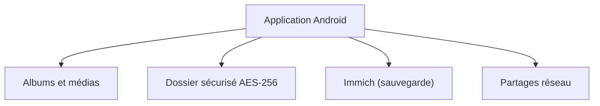

# kaii-lb/LavenderPhotos

> Android photo gallery app, with Immich backup, albums, tags and a secure folder.

## The problem
Android galleries impose their own album rules and collect data.

## What it actually does
Browsing by date, free-form albums, search by name, date or tag, trash, favorites, offline editing, AES-256 encrypted folder and backup via Immich. Browsing of network shares (Google Drive, SMB, FTP, S3, SSH via RSAF). More than 28 languages.

## How it is wired

Simplified diagram based on the sheet, no diagram provided.

## Trying it
```bash
git clone https://github.com/kaii-lb/LavenderPhotos.git && cd LavenderPhotos
mkdir keys
chmod +x ./build.sh
./build.sh release
```

## Cost and gotchas
Free. Building requires you to provide signing keys. Also available via F-Droid and IzzyOnDroid. Cloud backup depends on an Immich instance.

## What it is not
Not an AI tool: the README states that no data is collected or used for training.

## Alternatives
No alternative named in the README.

## For you
Consumer Android app unrelated to your field: ignore.
