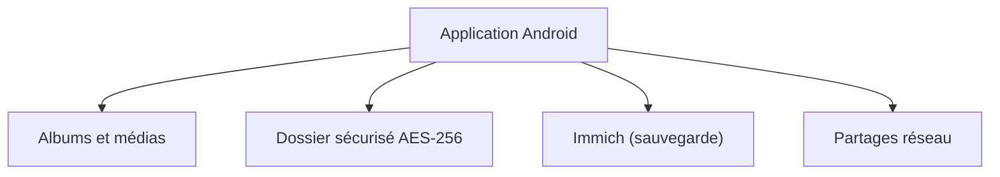

# kaii-lb/LavenderPhotos

> Application de galerie photo Android, avec sauvegarde Immich, albums, étiquettes et dossier sécurisé.

## Le problème
Les galeries Android imposent leurs règles d'albums et collectent des données.

## Ce que ça fait vraiment
Navigation par date, albums libres, recherche par nom, date ou étiquette, corbeille, favoris, édition hors ligne, dossier chiffré AES-256 et sauvegarde via Immich. Parcours de partages réseau (Google Drive, SMB, FTP, S3, SSH via RSAF). Plus de 28 langues.

## Comment c'est branché

Schéma simplifié d'après la fiche, sans diagramme fourni.

## Essayer
```bash
git clone https://github.com/kaii-lb/LavenderPhotos.git && cd LavenderPhotos
mkdir keys
chmod +x ./build.sh
./build.sh release
```

## Coût et pièges
Gratuit. Compilation avec clés de signature à fournir. Disponible aussi via F-Droid et IzzyOnDroid. Sauvegarde cloud dépend d'une instance Immich.

## Ce que ce n'est pas
Pas un outil d'IA : le README affirme qu'aucune donnée n'est collectée ni utilisée pour entraîner.

## Alternatives
Aucune alternative nommée dans le README.

## Pour toi
Application grand public Android sans lien avec ton métier : à ignorer.

