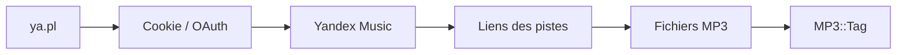

# kaimi-io/yandex-music-download

> Script Perl en ligne de commande qui télécharge albums, pistes et playlists depuis Yandex Music.

## Le problème
Yandex Music n'offre pas de téléchargement hors de son application ; ce script récupère les fichiers audio pour les ranger localement.

## Ce que ça fait vraiment
- Prend un identifiant ou une URL d'album, de piste ou de playlist.
- S'authentifie par cookie de session ou en-tête OAuth (API mobile).
- Choisit le débit, un motif de nom de fichier et de dossier, un délai, un proxy.
- Écrit les étiquettes MP3 ; peut seulement afficher les liens.

## Comment c'est branché
Schéma simplifié d'après la fiche, sans diagramme fourni.


## Essayer
```bash
git clone https://github.com/kaimi-io/yandex-music-download.git
cd yandex-music-download/src
perl ya.pl -h
perl ya.pl -a 123
```
Image Docker : `docker pull ka1mi/yandex-music-downloader:latest`.

## Coût et pièges
Perl 5.12 ou plus et une quinzaine de modules CPAN. Service accessible seulement en Russie et CIS, sauf abonnement ou proxy. Le cookie de session est un secret à ne pas laisser dans l'historique shell. Le téléchargement peut contredire les conditions du service (non traité dans le README).

## Ce que ce n'est pas
Pas un lecteur ni un outil de bibliothèque musicale. Il dépend d'une API non officielle, qui peut casser sans prévenir.

## Alternatives
Aucune alternative citée dans le README.

## Pour toi
À ignorer : aucun lien avec data, IA ou MLOps, et une dépendance fragile à un service tiers.

