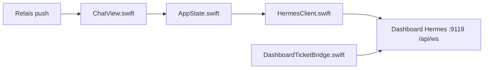

# kaishi00/hermes-conduit

> Native iOS client for Hermes Agent, to resume a self-hosted agent's sessions from an iPhone.

## The problem
Hermes Agent is used on a computer; resuming a conversation or approving a tool from the phone is not supported.

## What it actually does
SwiftUI app (iOS 17) connected to the Hermes dashboard over WebSocket (`/api/ws`): streaming chat, inspection of tool calls, voice (local recognition, Whisper, GPT-Live, Gemini Live, CarPlay), model switching, scheduled jobs, inline approvals, native OAuth, Face ID. Notifications go through a relay.

## How it is wired


## Trying it
```bash
git clone https://github.com/kaishi00/hermes-conduit.git
cd hermes-conduit
brew install xcodegen
xcodegen generate
open Conduit.xcodeproj
```

## Cost and gotchas
You need a Hermes instance with the native dashboard (port 9119), reachable via Tailscale or a reverse proxy. Notifications go through a shared relay (`push.milim.dev`), end-to-end encrypted with notifier 0.5 or higher; a personal relay only works with a build signed by your Apple account.

## What it is not
Not an agent: a client. Independent project, not affiliated with Nous Research. Useless without Hermes Agent.

## Alternatives
The README mentions no alternative.

## For you
Ignore unless you host Hermes Agent and use an iPhone: the client is clean, but without that agent it is of no use.
