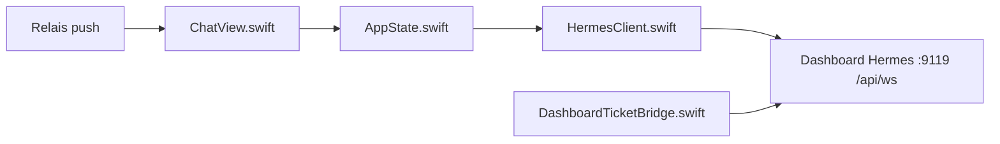

# kaishi00/hermes-conduit

> Client iOS natif pour Hermes Agent, pour reprendre depuis iPhone les sessions d'un agent auto-hébergé.

## Le problème
Hermes Agent s'utilise sur ordinateur ; reprendre une conversation ou approuver un outil depuis le téléphone n'est pas prévu.

## Ce que ça fait vraiment
App SwiftUI (iOS 17) connectée au tableau de bord Hermes par WebSocket (`/api/ws`) : chat en streaming, inspection des appels d'outils, voix (reconnaissance locale, Whisper, GPT-Live, Gemini Live, CarPlay), bascule de modèle, jobs planifiés, approbations en ligne, OAuth natif, Face ID. Les notifications passent par un relais.

## Comment c'est branché


## Essayer
```bash
git clone https://github.com/kaishi00/hermes-conduit.git
cd hermes-conduit
brew install xcodegen
xcodegen generate
open Conduit.xcodeproj
```

## Coût et pièges
Il faut une instance Hermes avec le tableau de bord natif (port 9119), joignable par Tailscale ou reverse proxy. Les notifications passent par un relais partagé (`push.milim.dev`), chiffré de bout en bout avec notifier 0.5 ou plus ; un relais perso ne marche qu'avec un build signé par ton compte Apple.

## Ce que ce n'est pas
Pas un agent : un client. Projet indépendant, non affilié à Nous Research. Inutile sans Hermes Agent.

## Alternatives
Le README ne cite aucune alternative.

## Pour toi
À ignorer sauf si tu héberges Hermes Agent et utilises un iPhone : le client est propre, mais sans cet agent il ne sert à rien.

