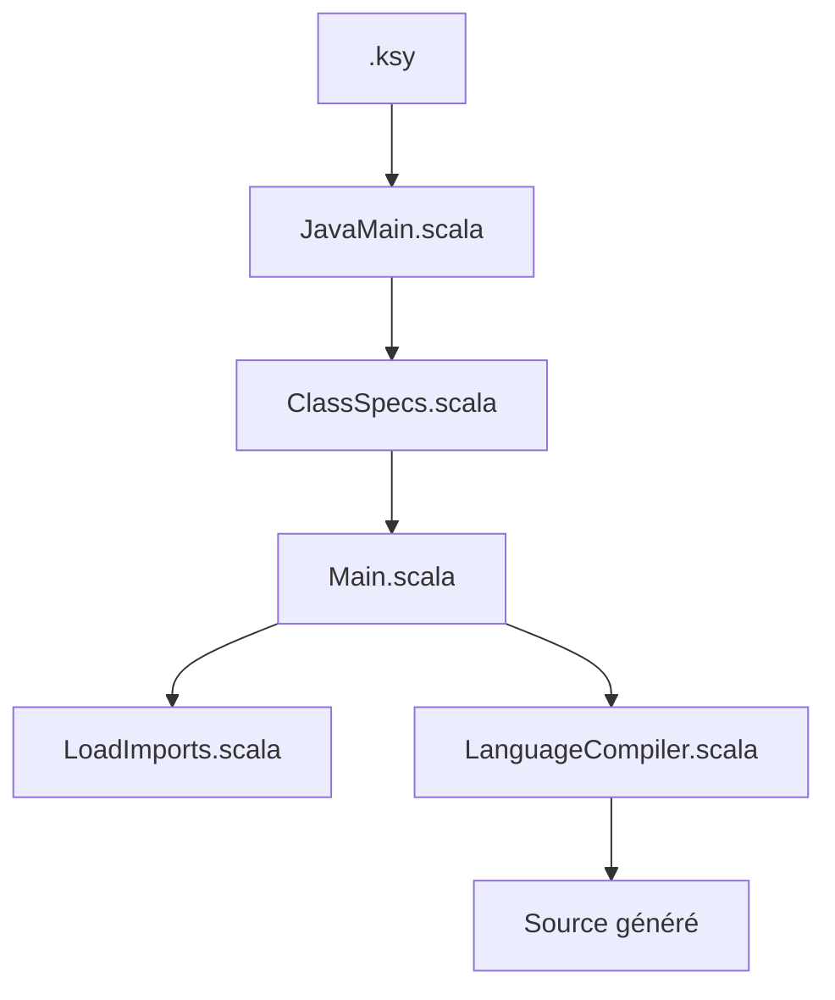

# kaitai-io/kaitai_struct_compiler

> Compiler that turns .ksy descriptions of binary formats into parsers in several languages.

## The problem
Writing parsers by hand for file formats or network packets is slow and fragile.

## What it actually does
You describe a format once in a `.ksy` file, the compiler loads the imports, builds and validates the model, then generates the parser code in the chosen target language. It also produces diagrams, HTML and Construct. Available as a JVM command line and as a JavaScript API.

## How it is wired

## Trying it
No command in the README: it points to the user guide, the downloads and the developer memo.

## Cost and gotchas
Free. GPL-3.0 license for the compiler alone; the generated code and your `.ksy` files belong to you. A JVM is required (Scala), absent from the prerequisites list.

## What it is not
Not an automatic reverse-engineering tool: you have to describe the format yourself.

## Alternatives
No alternative named in the README.

## For you
Worth watching: useful for reading binary formats from sensors or logs, with generated code that is free of the GPL.
