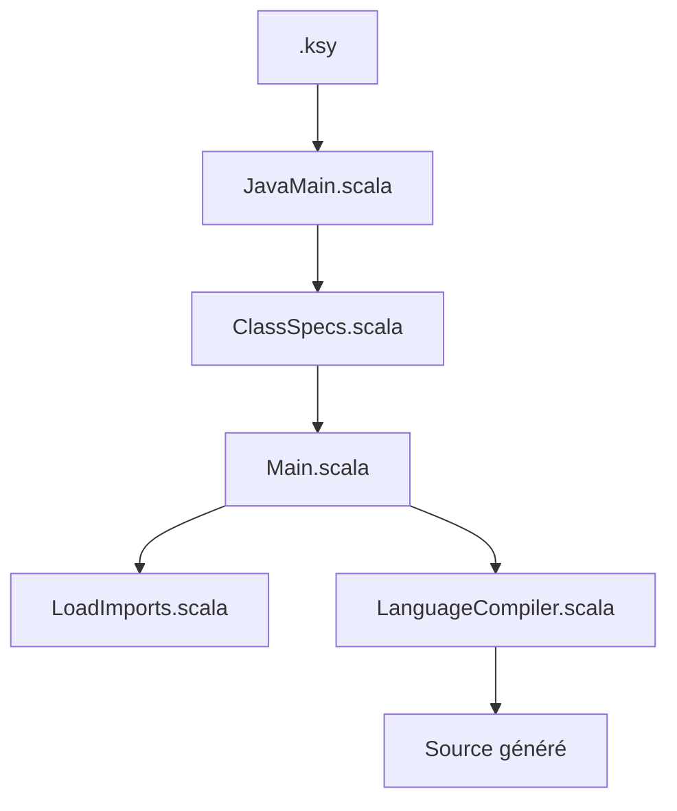

# kaitai-io/kaitai_struct_compiler

> Compilateur de descriptions .ksy de formats binaires en analyseurs dans plusieurs langages.

## Le problème
Écrire à la main des analyseurs pour des formats de fichiers ou de paquets réseau est long et fragile.

## Ce que ça fait vraiment
Tu décris un format une fois dans un fichier `.ksy`, le compilateur charge les imports, construit et valide le modèle, puis génère le code d'un analyseur dans le langage cible choisi. Il produit aussi des diagrammes, du HTML et du Construct. Disponible en ligne de commande JVM et en API JavaScript.

## Comment c'est branché

## Essayer
Aucune commande dans le README : il renvoie au guide utilisateur, aux téléchargements et au developer memo.

## Coût et pièges
Gratuit. Licence GPL-3.0 pour le compilateur seul ; le code généré et tes fichiers `.ksy` t'appartiennent. JVM nécessaire (Scala), absente de la liste des prérequis.

## Ce que ce n'est pas
Pas un outil de rétro-ingénierie automatique : il faut décrire le format soi-même.

## Alternatives
Aucune alternative nommée dans le README.

## Pour toi
À surveiller : utile pour lire des formats binaires de capteurs ou de logs, avec un code généré libre de la GPL.

