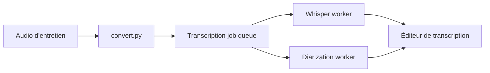

# kaixxx/noScribe

> Local desktop application that transcribes interviews with speaker identification, for researchers and journalists.

## The problem
Transcribing confidential interviews without sending them to the cloud or paying for a service.

## What it actually does
Converts the audio, runs Whisper (faster-whisper) for the text and pyannote for diarization in separate processes, then offers an editor to review and correct. About 60 languages, Windows, macOS and Linux. Installation and usage are described on noscribe.de.

## How it is wired

## Trying it
No command documented in the README; download and usage at https://noscribe.de.

## Cost and gotchas
Free, entirely local. The models run on your machine: a GPU helps. Beware of noscribe.ai, a domain unrelated to the project.

## What it is not
Not a cloud service nor a perfect transcription: proofreading is still needed. Oriented toward interviews, not video editing.

## Alternatives
No alternative named in the README.

## For you
Adopt for reliable local transcription with speakers: confidentiality, active project (push 2026-09), GPL has no consequence for end-user use.
