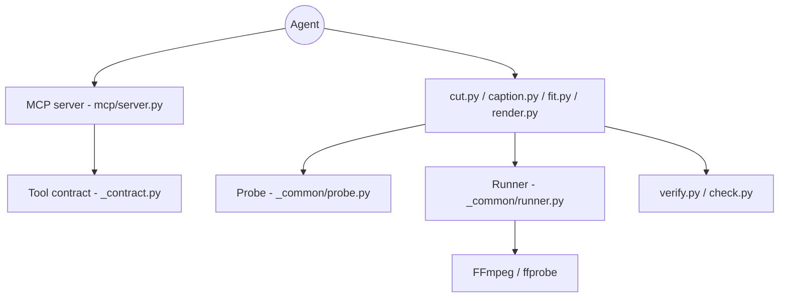

# kajisho5/ffmpeg-skill

> Skill and MCP server that let an agent edit videos with local FFmpeg, then verify the result.

## The problem
An agent that "knows FFmpeg" guesses the frame rate, picks an unsuitable codec, re-encodes for nothing and announces "done" without opening the file.

## What it actually does
Forty-two Python tools (standard library only) around `ffmpeg` and `ffprobe`: cut, join, silence removal, captions, 9:16 framing, loudness, per-platform export, project rendering. Enforced workflow: probe, edit losslessly when possible, verify. A machine-readable contract also feeds the MCP server. Everything stays local, no API key.

## How it is wired


## Trying it
```bash
npx ffmpeg-skill setup
npx ffmpeg-skill doctor
S=~/.claude/skills/ffmpeg-skill/scripts
python3 $S/probe.py input.mp4 --compact
python3 $S/render.py talk.mp4 --template tiktok --cues cues.txt
```

## Cost and gotchas
Node 16+, Python 3.10+ and FFmpeg in the PATH. Automatic captioning requires a local engine (faster-whisper or another) installed separately. An FFmpeg build lacking certain filters can make `doctor` fail.

## What it is not
Not a "brain": it decides neither the cuts nor the content, that is the agent's job. It detects no faces or subjects.

## Alternatives
No alternative named in the README (repositories from the author's ecosystem are listed as complements).

## For you
Worth watching if your agent handles video or audio: local and verifiable, but its usefulness depends on that need.
