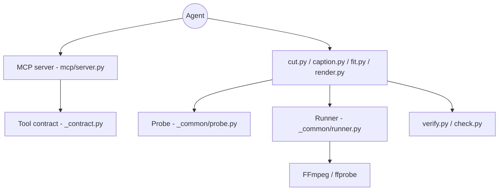

# kajisho5/ffmpeg-skill

> Skill et serveur MCP qui font monter des vidéos par un agent avec FFmpeg local, puis vérifient le résultat.

## Le problème
Un agent qui « connaît FFmpeg » devine la fréquence d'images, choisit un codec inadapté, ré-encode pour rien et annonce « fait » sans ouvrir le fichier.

## Ce que ça fait vraiment
Quarante-deux outils Python (bibliothèque standard seulement) autour de `ffmpeg` et `ffprobe` : coupe, jonction, suppression de silences, légendes, cadrage 9:16, loudness, export par plateforme, rendu de projets. Workflow imposé : sonder, éditer sans perte si possible, vérifier. Un contrat lisible par machine alimente aussi le serveur MCP. Tout reste local, sans clé d'API.

## Comment c'est branché


## Essayer
```bash
npx ffmpeg-skill setup
npx ffmpeg-skill doctor
S=~/.claude/skills/ffmpeg-skill/scripts
python3 $S/probe.py input.mp4 --compact
python3 $S/render.py talk.mp4 --template tiktok --cues cues.txt
```

## Coût et pièges
Node 16+, Python 3.10+ et FFmpeg dans le PATH. Le sous-titrage automatique exige un moteur local (faster-whisper ou autre) installé à part. Un seul build FFmpeg sans certains filtres peut faire échouer `doctor`.

## Ce que ce n'est pas
Pas un « cerveau » : il ne décide ni des coupes ni du contenu, c'est le travail de l'agent. Ne détecte aucun visage ni sujet.

## Alternatives
Aucune alternative nommée dans le README (des dépôts de l'écosystème de l'auteur sont listés comme compléments).

## Pour toi
À surveiller si ton agent traite de la vidéo ou de l'audio : local et vérifiable, mais l'utilité dépend de ce besoin.

