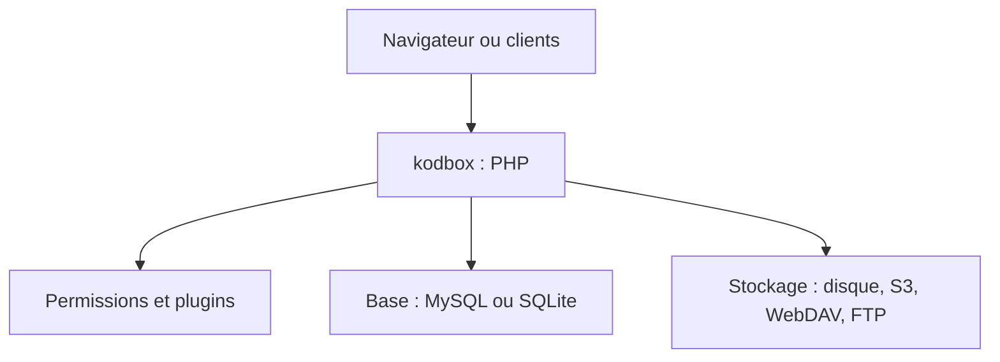

# kalcaddle/kodbox

> Private network drive in PHP, close to the Windows experience, with online preview and editing of many formats.

## The problem
Teams want a self-hosted file space, with fine-grained permissions and document preview, without a public cloud.

## What it actually does
Web file manager with drag-and-drop, historical versions, deduplication, search (including pinyin) and link sharing. It mounts local storage, FTP, WebDAV, OSS, COS, MinIO or S3-compatible. It also offers a plugin center (AD, WeCom, DingTalk) and mobile and PC clients.

## How it is wired
Simplified diagram based on the sheet, no diagram provided.



## Trying it
```bash
git clone https://github.com/kalcaddle/kodbox.git
chmod -Rf 777 ./kodbox/*
```

## Cost and gotchas
Suggested server: PHP 8.1, MySQL 5.7 and Redis. The proposed installation sets permissions to `777`, which is risky in production. No license declared.

## What it is not
Not a full collaborative suite like Nextcloud; not a data solution for AI. A PHP 5.3+ requirement is announced, in tension with the recommended PHP 8.1.

## Alternatives
No alternative named in the README.

## For you
Ignore: general-purpose file manager, without a clear license and outside your data, AI or MLOps scope.
