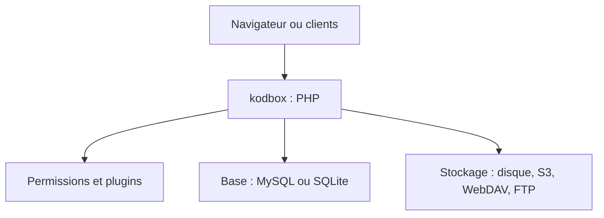

# kalcaddle/kodbox

> Disque réseau privé en PHP, proche de l'expérience Windows, avec aperçu et édition en ligne de nombreux formats.

## Le problème
Les équipes veulent un espace de fichiers autohébergé, avec permissions fines et aperçu de documents, sans cloud public.

## Ce que ça fait vraiment
Gestionnaire de fichiers web avec glisser-déposer, versions historiques, déduplication, recherche (y compris pinyin) et partage par lien. Il monte du stockage local, FTP, WebDAV, OSS, COS, MinIO ou compatible S3. Il propose aussi un centre de plugins (AD, WeCom, DingTalk) et des clients mobile et PC.

## Comment c'est branché
Schéma simplifié d'après la fiche, sans diagramme fourni.



## Essayer
```bash
git clone https://github.com/kalcaddle/kodbox.git
chmod -Rf 777 ./kodbox/*
```

## Coût et pièges
Serveur suggéré : PHP 8.1, MySQL 5.7 et Redis. L'installation proposée met les permissions en `777`, ce qui est risqué en production. Aucune licence déclarée.

## Ce que ce n'est pas
Pas une suite collaborative complète à la Nextcloud ; pas une solution de données pour l'IA. Exigence de PHP 5.3+ annoncée, en tension avec le PHP 8.1 conseillé.

## Alternatives
Aucune alternative nommée dans le README.

## Pour toi
À ignorer : gestionnaire de fichiers généraliste, sans licence claire et hors de ton périmètre data, IA ou MLOps.

