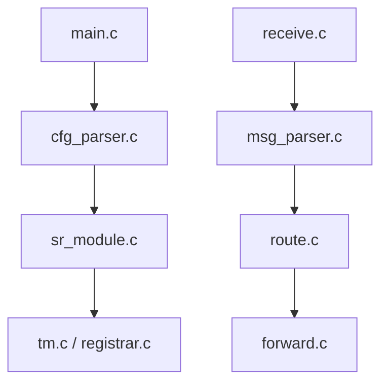

# kamailio/kamailio

> SIP signalling server written in C for VoIP carriers, messaging and presence at large scale.

## The problem
Routing millions of SIP calls between subscribers and carriers requires a signalling server that can handle the load without being a full PBX.

## What it actually does
Receives SIP messages (UDP, TCP, TLS, WebSocket), parses them, runs a routing script (`kamailio.cfg`) and then relays them. Loadable modules add transactions (`tm`), dialogs, registration (`registrar`/`usrloc`), destination selection (`dispatcher`, `drouting`). Database through MySQL, PostgreSQL, Redis, etc. Controlled via RPC and `kamctl`.

## How it is wired
Diagram based on the code diagram.



## Trying it
```bash
# README : installation depuis les sources ou paquets deb/rpm, voir
# https://www.kamailio.org/wikidocs/#installation
# Aucune commande de démarrage n'est donnée dans le README.
```

## Cost and gotchas
Free, but you need a hand-written routing script and often a database and third-party media relays. The licence is present but not identified by GitHub: check it before any commercial use.

## What it is not
Not a PBX nor a media server: it routes signalling, not audio. Not a ready-to-use tool, it is a configuration framework.

## Alternatives
No alternative named in the README (it only mentions SER, its ancestor, merged into the project).

## For you
Ignore for a data/AI/MLOps profile: this is telephony infrastructure, only useful if you are building a VoIP platform.
