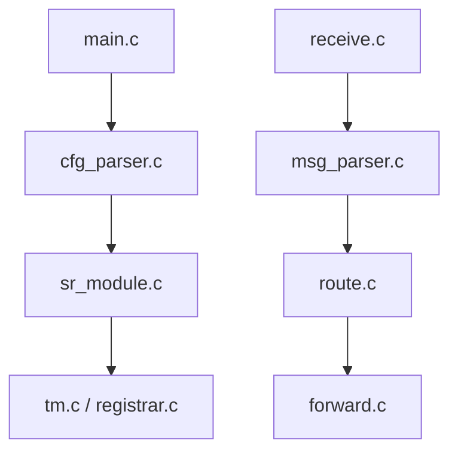

# kamailio/kamailio

> Serveur de signalisation SIP en C pour opérateurs VoIP, messagerie et présence à grande échelle.

## Le problème
Router des millions d'appels SIP entre abonnés et opérateurs demande un serveur de signalisation qui tienne la charge sans être un PBX complet.

## Ce que ça fait vraiment
Reçoit les messages SIP (UDP, TCP, TLS, WebSocket), les analyse, exécute un script de routage (`kamailio.cfg`) puis les relaie. Des modules chargeables ajoutent transactions (`tm`), dialogues, enregistrement (`registrar`/`usrloc`), choix de destination (`dispatcher`, `drouting`). Base de données via MySQL, PostgreSQL, Redis, etc. Pilotage par RPC et `kamctl`.

## Comment c'est branché
Schéma d'après le diagramme du code.



## Essayer
```bash
# README : installation depuis les sources ou paquets deb/rpm, voir
# https://www.kamailio.org/wikidocs/#installation
# Aucune commande de démarrage n'est donnée dans le README.
```

## Coût et pièges
Gratuit, mais il faut un script de routage écrit à la main et souvent une base de données et des relais média tiers. La licence est présente mais non identifiée par GitHub : à vérifier avant tout usage commercial.

## Ce que ce n'est pas
Pas un PBX ni un serveur média : il route la signalisation, pas l'audio. Pas un outil prêt à l'emploi, c'est un cadre de configuration.

## Alternatives
Aucune alternative nommée dans le README (il évoque seulement SER, son ancêtre, fusionné dans le projet).

## Pour toi
À ignorer pour un profil data/IA/MLOps : c'est de l'infrastructure téléphonie, utile seulement si tu bâtis une plateforme VoIP.

