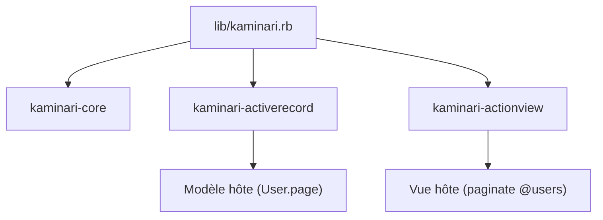

# kaminari/kaminari

> Ruby gem for scope-based pagination in Rails applications and other frameworks.

## The problem
Paginating records and displaying page links without polluting base classes.

## What it actually does
Adds the `page`, `per` and `padding` scopes to models and a `paginate` helper that renders HTML links via overridable partials. Handles i18n, view and configuration generation, `without_count` mode and generic arrays. Three gems: kaminari-core, kaminari-activerecord, kaminari-actionview. Adapters for Mongoid, Sinatra, Grape.

## How it is wired


## Trying it
```sh
bundle
rails g kaminari:config
rails g kaminari:views default
```
Add `gem 'kaminari'` to the Gemfile.

## Cost and gotchas
No cost. No `order` is added automatically: specify one to avoid unstable results.

## What it is not
Not a data/AI tool: pagination of Ruby web views.

## Alternatives
No alternative named in the README.

## For you
Ignore: only useful if you write a Rails application, which falls outside your profile.
