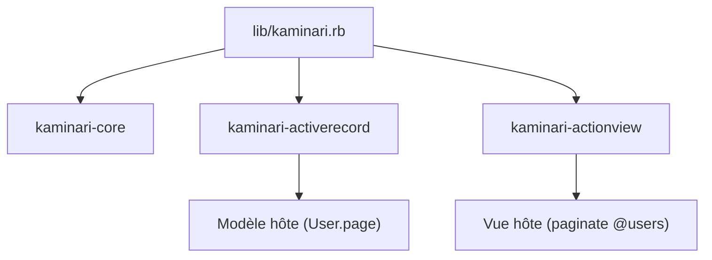

# kaminari/kaminari

> Gem Ruby de pagination par scopes pour applications Rails et autres frameworks.

## Le problème
Paginer des enregistrements et afficher les liens de pages sans polluer les classes de base.

## Ce que ça fait vraiment
Ajoute les scopes `page`, `per` et `padding` aux modèles et un helper `paginate` qui rend des liens HTML via des partials surchargeables. Gère i18n, génération de vues et de configuration, mode `without_count` et tableaux génériques. Trois gems : kaminari-core, kaminari-activerecord, kaminari-actionview. Adaptateurs pour Mongoid, Sinatra, Grape.

## Comment c'est branché


## Essayer
```sh
bundle
rails g kaminari:config
rails g kaminari:views default
```
Ajouter `gem 'kaminari'` au Gemfile.

## Coût et pièges
Aucun coût. Pas d'`order` ajouté automatiquement : le préciser pour éviter des résultats instables.

## Ce que ce n'est pas
Pas un outil data/IA : pagination de vues web Ruby.

## Alternatives
Aucune alternative nommée dans le README.

## Pour toi
Ignorer : uniquement utile si tu écris une application Rails, ce qui sort de ton profil.

