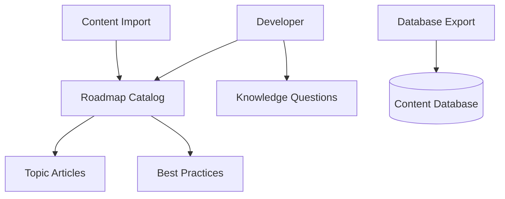

# kamranahmedse/developer-roadmap

> The content of the interactive learning paths on roadmap.sh, which consists of Markdown files organized by topic.

## The problem
Knowing what to learn, and in what order, when aiming for a career in software development or artificial intelligence.

## What it actually does
The repository contains the text of the roadmap nodes, organized as `roadmaps/<slug>/content/<topic-slug>@<node-id>.md`. Merged changes are automatically synchronized to the website. The catalog covers, among other things, the frontend, backend, AI agents, and AI data scientists.

## How it is wired
Simplified diagram based on the provided diagram.



## Trying it
```bash
git clone git@github.com:nilbuild/developer-roadmap.git --depth 1
cd developer-roadmap
```

## Cost and gotchas
Free. The deposit is not an application: the interactive experience is on roadmap.sh. The license is present but not identified by GitHub.

## What it is not
This is not an installation tool or the website's code: the runtime is not included in the repository. The synchronization scripts are reserved for maintainers.

## Alternatives
No alternative is specified in the README.

## For you
This should be consulted online as a skills development roadmap (AI and data), without duplicating anything: the repository only provides content.
